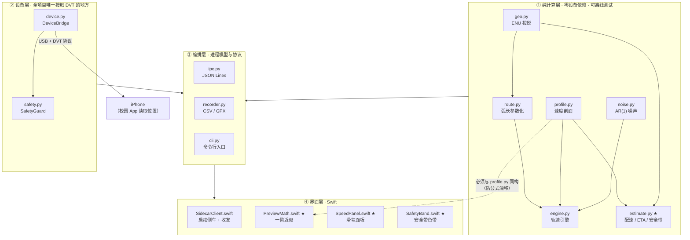
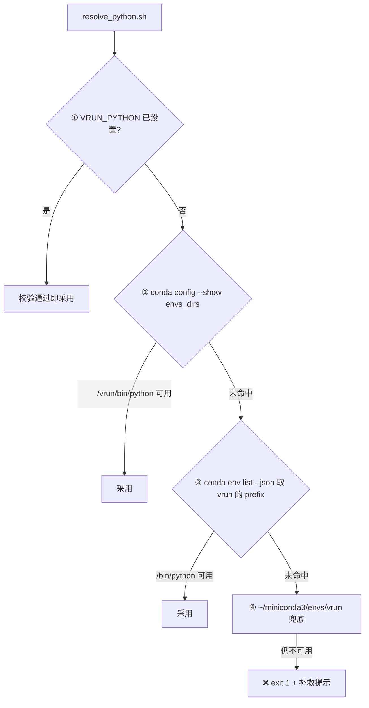

# VRun 代码文件清单（File Manifest）

> **本文定位**：`works.md` §4.4「目录结构」的**展开版**——回答「**哪个文件负责哪一块功能、边界在哪、接口长什么样**」。
>
> - `works.md` 回答「**做什么、为什么这么设计**」（物理约束、架构、面板规格、里程碑）
> - 本文回答「**代码怎么切分、每个文件写什么**」
> - **两者冲突时以 `works.md` 为准**。本文只做细化，不引入新需求。
>
> | 项 | 值 |
> | --- | --- |
> | 版本 | **v15（2026-10-21）** |
> | 对应 `works.md` | v10 |
> | 语言约定 | 代码注释、文档、GUI 文案**一律中文** |
> | 测试规模 | Python **471 passed** / Swift **79 passed** |
>
> ⚠️ **重要前提（v13 更新）**：本文 v1 写作时仓库内**尚无任何代码文件**，
> 全文描述的都是**待建文件的规格**。截至 v7，**M1 / M2 / M3 均已落地**，
> `src/vrun/` **16** 个文件与 `app/VRun/` **14** 个源码文件全部有实现（`git ls-files` 逐个核对，v8 新增 `LiveMetrics.swift`，v11 新增 `preview.py`）。
>
> 因此本文现在的地位是：
>
> - **已实现部分**（§4.1 §4.2 §4.3 §5）= 接口**契约**，改动须与代码同步；
> - **未实现部分**（仅剩 M5 的 `README.md`）= 仍是**设计约定**。
>
> 接手 Agent 应当**先看仓库里有什么**，再对照本文判断某处是「契约」还是「约定」。
>
> ⚠️ **计数纪律（v6 新增，v7 续用）**：本文所有「N 个文件 / N 项」都由 `git ls-files`
> 加未跟踪新文件**逐个核对**，不手写、不沿用上一版。
> v5 及之前页首与 §10 长期互相矛盾（分项 53 / 合计 54 / 页首 48），
> 且列着从未实现的 `bootstrap_env.sh` / `preflight.sh` —— 已一并纠正。

---

## 0. 快速索引

| 你想做什么 | 去哪一节 |
| --- | --- |
| 理解整体分层与切分理由 | §1 §2 |
| 写 Python 轨迹内核 / 估算 | §4.1 |
| 写 iPhone 位置注入 | §4.2 |
| 写协议、落盘、命令行 | §4.3 |
| 写 macOS GUI | §5 |
| 写测试 | §6 |
| 写运维脚本 | §7 |
| 查某文件属于哪个里程碑 | §10 |
| 确认哪些事绝对不能做 | §11 |

**一句话版本**

- 想要「**能离线测的数学**」→ `src/vrun/` 的 ① 纯计算层，**7** 个文件
- 想要「**能控制手机**」→ `src/vrun/device.py` + `src/vrun/safety.py`
- 想要「**滑块面板**」→ `app/VRun/Sources/VRunApp/` 里带 ★ 的 4 个文件
- 想要「**证明它是对的**」→ `tests/` + `tests/golden/estimate.json`

**规模概览**：全项目共 **75 项 = 74 个文件 + 1 个运行时目录**（详见 §10 交叉表）。

---

## 1. 分层总览

按「**能不能脱离 iPhone 独立验证**」切成四层：



**图里有两个箭头值得单独盯住**

1. `DEV → PHONE`：**全项目唯一**跨出 macOS 的边界，被孤立在 ② 层。所有不确定性与失败模式都集中在这一条线上。
2. `PROFILE ⇢ PM`（虚线）：表示「逻辑上必须同构」——`PreviewMath.swift` 是 `profile.py` 公式的 Swift 镜像，靠 `tests/golden/estimate.json` 强制对齐（works.md §5.6）。虚线而非实线，是因为两者**不通过代码共享**，只通过**基准数据**对齐。

---

## 2. 分层原则（为什么这么切）

判据只有一个：**能不能脱离 iPhone 独立验证**。

| 层 | 判定标准 | 允许的第三方依赖 |
| --- | --- | --- |
| ① 纯计算 | 输入 dict / 输出 dict；不碰 USB、不碰设备、不做进程管理 | 仅 `numpy` |
| ② 设备 | **全项目唯一**允许 `import pymobiledevice3` 的地方 | ① 层 + `pymobiledevice3` |
| ③ 编排 | 进程生命周期、协议编解码、落盘 | ①② |
| ④ 界面 | 只负责显示与交互，不承载业务公式 | Swift 标准库 + MapKit |

**三条硬约束**（违反任意一条，M1 的「无手机开发」就会崩）

1. **① 层不许 `import` ② 层，也不许 `import pymobiledevice3`。**
   否则在没插手机的机器上连单元测试都跑不起来——而 M1 的全部价值就在于「手机不在场也能推进」。
2. **`estimate.py` 与 `engine.py` 必须共用同一个 `SpeedProfile` 类**（works.md §4.3.5）。
   不允许各自实现一套速度公式。这是风险 R-8「预览与实际漂移」的结构性防线。
3. **① 层的随机性只允许来自显式传入的 `numpy.random.Generator`**，禁止使用全局 `np.random.*`。
   理由：全局状态会让「同种子 ⇒ 逐字节可复现」这条验收标准失效（详见 §4.1.4）。

---

## 3. 仓库根目录

| 文件 | 职责 | 里程碑 | 状态 |
| --- | --- | --- | --- |
| `works.md` | 工程文档主文件。另一 Agent 的唯一真相源 | — | ✅ 已存在 |
| `.gitignore` | 忽略规则（见 §3.1） | M0 | ✅ 已存在 |
| `LICENSE` | MIT | — | ✅ 已存在 |
| `requirements.txt` | **pip 层依赖的唯一权威声明** | M0 | ✅ 已存在 |
| `environment.yml` | conda 环境 `vrun`（python=3.12；pip 段**只引用** `requirements.txt`，不展开包名） | M0 | ✅ 已存在 |
| `README.md` | 从零上手：建环境 → 跑离线测试 → 连手机 → 开 GUI | M5 | ⬜ 待建 |
| `docs/` | 见 §8 | — | ✅ 本轮新建 |
| `logs/` | 运行记录（**不入库**） | — | 运行时生成 |

### 3.1 `.gitignore` 应覆盖的项

| 类别 | 条目 |
| --- | --- |
| Cyrene 工作底稿 | `.cyrene/` |
| macOS | `.DS_Store` |
| Python | `__pycache__/`、`*.pyc`、`.pytest_cache/`、`*.egg-info/` |
| 虚拟环境 | `venv/`、`.venv/` |
| Swift 构建 | `.build/`、`app/VRun/.build/` |
| 运行产物 | `logs/`、`*.log` |

> `logs/` 不入库是**刻意的**：真实跑动日志会包含博文在校园的坐标轨迹，属于个人位置数据，不应该进版本历史。

---

## 4. Python 侧车 · `src/vrun/`

包名 `vrun`，**16 个文件**。

其中**只有 3 个文件与设备或进程强相关**（`device.py` / `safety.py` / `cli.py`），其余 11 个都能在没手机的机器上完整运行与测试。

### 4.0 包结构与入口

| 文件 | 职责 | 里程碑 |
| --- | --- | --- |
| `src/vrun/__init__.py` | 包声明、`__version__`、对外导出清单 | M1 |
| `src/vrun/__main__.py` | `python -m vrun` 入口 → 转发到 `cli.main()` | M1 |

> `__init__.py` 里**不要** import `device.py`——那会把 `pymobiledevice3` 变成包级强依赖，
> 一旦它没装好，连 `vrun estimate` 都用不了。设备相关一律在 `cli.py` 中**延迟导入**。

---

### 4.1 ① 纯计算层（7 个文件）

> 这一层是**风险最低、价值最高**的部分：不需要 iPhone、不需要 Xcode、不需要联网，
> `pytest` 秒级跑完。**M1 阶段全部可交付。**
> 滑块面板的全部数学逻辑，都能在这一层离线验证完。

#### 4.1.1 `src/vrun/geo.py` — 坐标数学底座

| 项 | 内容 |
| --- | --- |
| **职责** | 经纬度 ↔ 局部 ENU 米制平面的双向投影；haversine 距离；方位角 |
| **为什么存在** | 噪声是**米制**叠加的，而注入接口只吃**经纬度**。中间必须有且只有一次换算，否则误差会在两套单位间反复污染 |
| **依赖** | 仅 `math`（标量运算用标准库更快，numpy 在此无收益） |
| **里程碑** | M1 |

接口约定：

```python
class ENUProjector:
    """以 origin 为原点的局部等距圆柱投影（江安校区尺度误差 < 0.1%）。"""

    def __init__(self, origin_lat: float, origin_lon: float) -> None: ...

    def to_enu(self, lat: float, lon: float) -> tuple[float, float]:
        """经纬度 → (东, 北)，单位米。"""

    def to_latlon(self, e: float, n: float) -> tuple[float, float]:
        """(东, 北) 米 → 经纬度。必须是 to_enu 的严格逆运算。"""


def haversine(lat1: float, lon1: float, lat2: float, lon2: float) -> float:
    """两点大圆距离，单位米。"""


def bearing(lat1: float, lon1: float, lat2: float, lon2: float) -> float:
    """起点指向终点的方位角，单位度；正北为 0，顺时针为正。"""
```

**设计要点**

- 用**等距圆柱（equirectangular）近似**，而非完整大地测量：
  纬度 30.6° 附近、跨度 < 5 km 时相对误差 < 0.1%，比 Vincenty 快两个数量级，且**可闭式反解**。
- `to_enu` / `to_latlon` **必须严格互逆**（往返误差 < 0.1 m），这是 `test_geo.py` 的头号断言。
- 经度方向的尺度因子要乘 `cos(origin_lat)`——这是等距圆柱唯一容易写错的地方。
- 方位角只用于**可选**的调试输出（DVT 不接收 course，见 works.md §1.2），实现可以很简单。

**测试方式**：`tests/test_geo.py`——往返误差、已知两点距离对照、方位角四个象限。

---

#### 4.1.2 `src/vrun/route.py` — 路线模型与弧长参数化

| 项 | 内容 |
| --- | --- |
| **职责** | 折线路线模型；累计弧长表；`point_at(s)` 按弧长取点；按目标距离等比缩放；**圆形路线与重复圈**；JSON 读写 |
| **为什么存在** | 引擎只推进一个标量 `s`（弧长），几何细节全部封在这里。这是「速度 = 推进弧长的速率」这一核心设计的落地处（works.md §2.2） |
| **依赖** | `geo.py` |
| **里程碑** | M1 |

接口约定：

```python
class Route:
    points: list[tuple[float, float]]   # [(lat, lon), ...] 折线顶点

    def length(self) -> float:
        """总长度，单位米。"""

    def point_at(self, s: float) -> tuple[float, float, float]:
        """★ 核心接口：弧长 s（米）→ (lat, lon, bearing)。
        s 超出 [0, length] 时钳制到端点。"""

    def scaled_to(self, target_m: float) -> "Route":
        """绕质心等比缩放，使总长等于 target_m（用于把随手画的路线凑成 3 km）。"""

    def to_json(self, path: str) -> None: ...
    @classmethod
    def from_json(cls, path: str) -> "Route": ...
```

**设计要点**

- `point_at(s)` 是**引擎唯一接触几何的入口**。实现：累计距离数组 + `bisect` 二分定位线段 + 线段内线性插值，复杂度 O(log n)。
- 缩放是**等比**的，会同时改变路线的形状尺度；这是可接受的——地图上随手画的路线本来就只是个赛道形状，不要求与真实道路严格对齐。
- JSON 格式要**稳定且向后兼容**（GUI 会写、侧车会读）：建议 `{"version": 1, "points": [[lat, lon], ...]}`。带版本号是为了将来改格式时能识别旧文件。

**测试方式**：`tests/test_route.py`——总长误差 < 0.5%、`point_at(0)` / `point_at(length)` 等于首尾点、`point_at(length/2)` 落在中点附近、缩放后长度正确。

---

#### 4.1.3 `src/vrun/profile.py` — 速度剖面（单一真相源）★

| 项 | 内容 |
| --- | --- |
| **职责** | works.md §3.2 的四段叠加剖面 + §3.3 预设档位 + 硬夹紧 |
| **为什么是 ★** | `engine.py` 与 `estimate.py` **都 import 这一个类**。这是防「预览说 18:09、实际跑 18:40」的结构性保证（风险 R-8） |
| **依赖** | 无第三方（纯标量运算） |
| **里程碑** | M1 |

接口约定：

```python
@dataclass
class SpeedProfile:
    v_bar: float = 10.0          # 目标稳态速度 km/h（由滑块给出）
    t_w: float = 30.0            # 起步 ramp 时长，秒
    r0: float = 0.8              # 起步初速比（0.8 → 从 8 km/h 起）
    delta: float = -0.015        # 疲劳漂移（全程线性）
    finish_frac: float = 0.08    # 终点冲刺区段长度（占总距离比例）
    f: float = 0.05              # 冲刺幅度
    v_floor: float = 6.3         # 硬夹紧下界
    v_ceil: float = 16.7         # 硬夹紧上界
    clamp_enabled: bool = True   # 贴线设定时必须置 False（works.md §3.2 注）

    def speed_at(self, t: float, s: float, total: float) -> float:
        """t = 已用时(s)，s = 已走弧长(m)，total = 总弧长(m) → 目标速度 km/h。"""

    def expected_duration(self, distance_m: float) -> float:
        """对完整剖面数值积分，得到走完全程所需秒数（精确 ETA）。"""


PRESETS: dict[str, float] = {
    "慢跑/快走": 7.0,
    "常规慢跑": 8.5,
    "标准": 10.0,
    "进阶": 12.0,
    "快跑": 14.0,
    "贴近上限": 16.5,
}
```

**设计要点**

- `clamp_enabled` 是**必需的开关**，不是可选优化：滑块允许把 `v̄` 设到 `6.0` 或 `17.0`（贴线测试），
  此时夹紧必须让位，否则测不出边界行为（works.md §3.2 末尾的 ⚠️）。
- ramp 用 `r0 = 0.8` 而非更真实的 0.6：起跑瞬间不会掉到 6 km/h 以下，
  避免「为了真实反而触发过慢判定」。更冒险的 `r0 = 0.6` 留作「冷启动」预设。
- `expected_duration()` 用数值积分（梯形法，步长 ≤ 0.05 s）而非一阶近似——
  它是 §3.6 那个闭式解的**权威版本**，闭式解只供 GUI 拖动时用。
- **禁止**在本文件之外出现第二份速度公式（works.md §11）。

**测试方式**：`tests/test_profile.py`——稳态速度误差 < 1%、clamp 生效、ramp 段不越界、`t_w` 之后回到 `v̄`。

---

#### 4.1.4 `src/vrun/noise.py` — 双层 AR(1) GPS 噪声

| 项 | 内容 |
| --- | --- |
| **职责** | works.md §3.4 的**双层一阶高斯马尔可夫过程**（慢漂移 + 快抖动），东 / 北各一路独立；可选跳点注入 |
| **依赖** | `numpy`（纯计算层里唯一用 numpy 的文件） |
| **里程碑** | M1 |

接口约定：

```python
class AR1:
    """一阶自回归过程：n_{k+1} = ρ·n_k + √(1−ρ²)·σ·ε，其中 ρ = exp(−Δt/τ)。"""

    def __init__(self, sigma: float, tau: float, dt: float,
                 rng: np.random.Generator) -> None: ...

    def step(self) -> float: ...


class GPSNoise:
    """双层噪声：慢漂移(σ=3.0 m, τ=300 s) + 快抖动(σ=0.3 m, τ=1.5 s)，东/北独立。"""

    LEVELS = {"off": 0.0, "realistic": 1.0, "harsh": 1.5}   # 相对基准的缩放系数

    def __init__(self, level: str, sample_rate: float, seed: int,
                 enable_spikes: bool = False) -> None: ...

    def sample(self) -> tuple[float, float]:
        """返回本次采样的 (de, dn)，单位米。"""

    def reset(self) -> None:
        """回到初始状态，使同一种子能重复生成整段轨迹。"""
```

**设计要点（三条，都很关键）**

1. **必须用 `np.random.default_rng(seed)`，禁止 `np.random.seed()` 与全局 `np.random.*`。**
   原因：全局状态会被任何第三方库的随机调用污染，导致「同种子 ⇒ 逐字节可复现」这条验收标准失效。
   `default_rng` 返回独立的 Generator 对象，且 numpy 对 PCG64 的比特流有**跨版本兼容承诺**。
2. **`ρ = exp(−Δt/τ)` 必须按实际 `Δt` 重算，不能缓存常量。**
   采样率从 5 Hz 切到 0.5 Hz 时 ρ 变化极大，缓存会让「切换采样率」这个动作在数值上失真。
3. `LEVELS` 的键是英文（`off` / `realistic` / `harsh`），对应 works.md §3.4 的三个中文档位（关 / 真实 / 严苛）。
   映射表只在这里维护，GUI 只传英文键——避免中文字符串同时散落在 Python 与 Swift 两侧。

**测试方式**：`tests/test_noise.py`——同种子逐字节一致；后验 σ 与自相关符合设定值 ±10%；跳点关闭时不产生离群点。

---

#### 4.1.5 `src/vrun/engine.py` — 轨迹引擎

| 项 | 内容 |
| --- | --- |
| **职责** | 按**真实时钟**积分弧长，按采样率吐出 `(t, lat, lon, s, v)` 序列 |
| **依赖** | `route` / `profile` / `noise` |
| **里程碑** | M1 |

接口约定：

```python
@dataclass
class Sample:
    t: float          # 已用时，秒
    lat: float
    lon: float
    s: float          # 已走弧长，米
    v_target: float   # 剖面给出的目标速度，km/h
    v_actual: float   # 本段实际平均速度，km/h（含噪声位移的影响）


class TrackEngine:
    def __init__(self, route: Route, profile: SpeedProfile,
                 noise: GPSNoise, sample_rate: float) -> None: ...

    def run(self, on_sample: Callable[[Sample], None],
            clock: Callable[[], float] = time.monotonic) -> "RunStats":
        """推进到路线终点；每到一个采样点调用 on_sample。"""

    def simulate_offline(self) -> list[Sample]:
        """★ 注入假时钟，把整段轨迹一次算完（测试用，秒级完成）。"""
```

**★ 关键设计：`clock` 可注入**

| 场景 | 传入的 clock | 效果 |
| --- | --- | --- |
| 真机跑 | `time.monotonic`（默认） | 按真实流逝时间推进 |
| 离线测试 | 「每次调用 +1 s」的假时钟 | **18 分钟的仿真在测试里 0.1 秒跑完** |

没有这个参数，M1 的验收测试（「离线跑 3 km 并统计平均速度」）根本没法做——
总不能每次跑测试都真的等 18 分钟。

**其它要点**

- 积分为 `s += v · Δt`，其中 `Δt` 由 `clock()` 的差值给出。
  **绝不能用固定 dt**：DVT 往返延迟会让固定 dt 与实际时间脱节，速度随之失真（works.md §4.3.1）。
- 每步结束判断 `s ≥ route.length()`：超出的部分**钳制到终点**，不做回退。
- `v_actual` 用「两点间大圆距离 ÷ Δt」计算，**含噪声位移**——它才是 iPhone 侧 App 看到的速度。
  这正是 §3.5「表观速度抖动」在代码里的对应物。

**测试方式**：`tests/test_engine.py`——用假时钟离线跑完 3 km；平均速度误差 < 1%；总距离误差 < 0.5%；
实测 ETA 与 `estimate` 预测差 < 2 s。

---

#### 4.1.6 `src/vrun/estimate.py` — 配速 / ETA / 安全带 ★

| 项 | 内容 |
| --- | --- |
| **职责** | GUI 预览的**权威数值来源**。§3.6 闭式解 + 精确 ETA + §3.5 表观抖动 + §5.3 安全带 + §5.4 golden 表 + R1–R5 判定预期。**纯计算，不碰设备** |
| **为什么是 ★** | `vrun estimate` 不需要设备 ⇒ **滑块面板的全部逻辑在 M1 就能离线验证完** |
| **依赖** | `profile` / `geo` |
| **里程碑** | M1 |

接口约定：

```python
@dataclass
class EstimateResult:
    speed_kmh: float
    distance_m: float
    noise_level: str
    sample_rate: float

    pace_s_per_km: float                      # 配速，秒每公里
    pace_str: str                             # "6:00"
    eta_naive_s: float                        # 纯运动（D / v）
    eta_s: float                              # 修正 ETA（数值积分，**权威**）
    eta_closed_form_s: float                  # 修正 ETA（一阶近似，GUI 拖动用）
    eta_str: str

    sigma_v: float                            # 表观速度抖动 1σ，km/h
    band_1sigma: tuple[float, float] | None   # v̄ 的可行区间，见下方⚠️
    band_2sigma: tuple[float, float] | None   # None = 无安全带（严苛档退化）
    safety: str                               # "green" / "yellow" / "red"（works.md §5.3）
    v_lo: float                               # 本设定下瞬时速度的慢端 = v̄(1+δ) − 2σ
    v_hi: float                               # 本设定下瞬时速度的快端 = v̄(1+f) + 2σ

    verdict: dict[str, str]                   # {"R1": "✓", "R3": "⚠️ 临界", ...}
    clamp_enabled: bool                       # 贴线设定时为 False


def estimate(speed_kmh: float, distance_m: float = 3000.0,
             noise_level: str = "realistic", sample_rate: float = 1.0,
             profile: SpeedProfile | None = None,
             seed: int = 0) -> EstimateResult: ...


def sigma_apparent(dt: float, level: str = "realistic") -> float:
    """works.md §3.5：单轴差分标准差 → 二维位移误差 → 表观速度误差。"""


def safety_band(sigma_v: float, profile: SpeedProfile,
                levels: float = 2.0) -> tuple[float, float] | None:
    """works.md §5.3：返回「levels·σ 内绝不越界」的 **v̄ 区间**；无解返回 **None**。

    ⚠️ **别把它和 `v_lo` / `v_hi` 搞混** —— works.md §5.4 里两种量都出现了：

    | 量 | 含义 | 回答的问题 |
    | --- | --- | --- |
    | `band_2sigma` | **v̄ 的可行区间** | 滑块该停在哪儿才安全？ |
    | `v_lo` / `v_hi` | 某个既定 v̄ 下**瞬时速度**的取值范围 | 现在这个设定会被噪声推到哪？ |

    `levels` 参数是必需的 —— 面板要同时画 1σ（黄）与 2σ（绿）两条带。
"""
```

**两条必须实现的退化路径**（否则会把「真实结论」当成 bug 修掉）

1. **严苛档安全带为空集** → `band_2sigma = None`，附原因文本，**不画绿带**。
   验算：`v̄·0.985 − 6 ≥ 6 ⇒ v̄ ≥ 12.18`，同时 `v̄·1.05 + 6 ≤ 17 ⇒ v̄ ≤ 10.48`，交集为空。
2. **贴线设定（6.0 / 17.0）不阻止** → 正常返回结果，只在 `verdict` 里标 `⚠️`。
   滑块允许越界设定是刻意的（works.md §3.2），工具只负责**如实预警**。

**设计要点**

- `eta_s` **必须调 `profile.expected_duration()`**，不许另写一阶近似。
  这正是 §4.3.5「单一真相源」的落地点。
- `band_2sigma` 的边界要按 §5.3 含 δ 与 f 的公式算，**不能简单用 ±2σ 加减 `v̄`**——
  冲刺抬升与漂移压低会让安全带显著收窄（合法窗口 6–17，但 2σ 安全带只有 10.2–12.4）。
- `verdict` 是**预测**，供实测比对（works.md §5.5）。键名固定为 `R1`…`R5`，与规则一一对应。

**测试方式**：`tests/test_estimate.py`——逐行断言 §5.4 全表（11 行 golden values）；
严苛档返回 `None`；贴线设定不被拒绝。

---

#### 4.1.7 `src/vrun/preview.py` — 离线推算「校园 App 会看到什么」★★

| 项 | 内容 |
| --- | --- |
| **职责** | 不连手机跑完整条轨迹，算出校园 App 在 R1–R5 下的判定（**两种口径**）、电子围栏最远距离、平滑窗口敏感性 |
| **为什么存在** | 「要不要占手机 19 分钟」这个决定，必须能在**不占**的前提下做出。而 App 的距离 ≠ 我们的弧长，且差多少**只能算** |
| **依赖** | `engine.py`（假时钟 `simulate_offline`）、`geo.py`、`noise.py`、`profile.py`、`estimate.py`、`route.py` |
| **里程碑** | M4 |

**接口**

```python
def preview(route, *, center, diameter_m, laps=1, speed_kmh=10.0, rate_hz=1.0,
            noise_level="realistic", seed=0, smooth_s=5.0,
            radius_limit_m=None, sweep_windows=()) -> PreviewResult: ...

def plan_laps(center, diameter_m, *, speed_kmh=10.0, min_laps=1, max_laps=400,
              min_margin=0.02, ...) -> PreviewResult: ...
    """搜出「R1 与 R4 在两种口径下都过、且 R1 余量 ≥ min_margin」的最小圈数。"""

def checks(p, model: str) -> list[Check]: ...
    """model = "raw"（App 不滤波）/ "smooth"（App 做 p.smooth_s 秒滑动平均）。"""
```

**设计要点**

- **为什么必须两种口径**：我们**不知道**校园 App 内部有没有做平滑滤波，也**不去分析**它。
  两种都算出来，跑完看 App 报的数落在哪一边，**顺带就把它的滤波口径反推出来了** ——
  这比任何黑盒分析都直接，而且完全合规（只看它自己显示的数字）。
- **为什么 R3 不进 `plan_laps`**：逐点最低速随采样点增多而**变差**（噪声差分能抵消前进量），
  写进搜索条件会得到无解目标，一路撞到 `max_laps`（实测 400 圈 / 113 秒）。
- **围栏参考系必须用真圆心**，不是引擎内部那个「路线首点」——
  路线首点在圆的东侧、离圆心 15 m，拿它当原点会让整个围栏判定偏移一整个半径。
- ⚠️ `checks()` 的 `margin()` 分母用**边界自身的量级**。
  第一版写成 `gap / (value - lo)`，分子分母同一个数 ⇒ **恒等于 1.0**，
  「压线」与「稳过」在搜索眼里完全一样（F17）。

**测试方式**：`tests/test_preview.py`（32 条）——余量分母、围栏参考系、
窗口单调性、弦<弧、种子可复现性、圈数稳健性；配 **12 组变异**全部命中。

---

### 4.2 ② 设备层（2 个文件）

> **全项目唯一允许 `import pymobiledevice3` 的地方。**
> M1 完全不需要它，M2 才动。`safety.py` 的骨架在 M1 就能用**假 bridge** 写完并单测。

**M2 实装状态（2026-10-14）**：`device.py` / `safety.py` / `scripts/panic-clear.sh` 已落地，
CLI 与 ipc 的 `device.status` / `device.cleanup` 已接通，测试 234 → **269 全绿**。
⚠️ **但真机一行都没验** —— 写代码时设备未接（`usbmux list` → `[]`）。
**「按 API 写对了」不等于「跑通了」**，M2 的验收仍需插上手机重跑。

#### 4.2.1 `src/vrun/device.py` — DeviceBridge

| 项 | 内容 |
| --- | --- |
| **职责** | 封装 `pymobiledevice3` 的 `LocationSimulation`：连接 → 探测 DDI → 建隧道 → `set` / `clear` |
| **依赖** | `pymobiledevice3` |
| **里程碑** | ✅ M2 已落地 |

接口约定：

```python
@dataclass
class DeviceStatus:
    connected: bool
    ddi_mounted: bool
    tunnel_up: bool
    device_name: str | None
    ios_version: str | None
    error: str | None = None


class DeviceBridge:
    async def connect(self) -> None: ...
    async def mount_ddi(self) -> None: ...
    async def start_tunnel(self) -> None: ...

    async def set_location(self, lat: float, lon: float,
                           timeout: float = 2.0) -> None:
        """注入一个坐标。带超时与有限重试。"""

    async def clear(self) -> None:
        """停止模拟。**幂等**：重复调用不报错。"""

    def status(self) -> DeviceStatus: ...
```

**设计要点**

- 上游 CLI 用法（works.md §1.2 已核实）：
  `pymobiledevice3 developer dvt simulate-location {set|clear|play}`；
  Python API 为 `LocationSimulation`（async context manager）。
- **`set_location` 内部不做清理。** 清理是 `SafetyGuard` 的独占职责（见 §4.2.2）——
  两处都管清理必然导致逻辑分叉，而清理逻辑一旦分叉就是安全红线。
- 每次 `set` 带 `timeout`（默认 **5 s**，见下方 F22 注）与**有限重试**（例如 2 次）。失败必须抛结构化异常，
  **不许静默吞掉**：静默失败会让轨迹出现无声的空洞，而日志上一切正常。
- 抛出的 `InjectionError` 必须带 `timeout_exhausted` 标记，**区分「超时」与「其他错误」**：
  超时是**可恢复**的（设备多半还连着），上层据此**降级继续**；
  其他错误（隧道掉了 / 通道断了）重试没有意义，上层据此**立刻失败**。
  标记由**设备层如实给出** —— 不让上层去猜异常文本（F22）。

**实测核对过的上游 API（2026-10-14，11.27.2）—— 非凭记忆**

| 事实 | 出处 / 后果 |
| --- | --- |
| `LocationSimulation.set(latitude, longitude)` —— **只有两个参数** | M0 那条「`altitude` 恒为 0.00、`horizontalAccuracy` 恒为 5.0」由此得到解释：上游**根本没提供**这两个入口 |
| `stopLocationSimulation` 是 `expects_reply=False` | `clear()` 不等设备回应，但仍要靠主 event loop 把字节写出去 —— 这是 §4.2.2 那条技术难点的根 |
| 隧道是**进程级单例**（PyTCP 网络栈全局唯一） | 第二次建隧道必然失败 ⇒ `ipc.py` 里所有 `device.*` 命令必须共用**同一个** `_shared_bridge()` |
| RSD 对象有 `close()` / `__aexit__` | 隧道必须显式关，否则进程退出时泄漏 |
| 降级链：macOS 先 `native_tunnel.establish_native_rsd`，失败回落 `userspace_tunnel.establish_userspace_rsd` | 照抄上游 `cli_common.make_rsd_dependency`，不自己发明顺序 |

**⚠️ DDI 刻意做成「尽力而为的探测」，不是硬性前置条件。**
   实测（§6 M0）本机 DDI `com.apple.MobileAsset.DDI 27.1.266.1` 已以 cryptex 形式在位，
   iOS 17+ 由系统托管，不存在「手动 mount 一份 DDI」的老流程。
   硬卡这一步只会把一个无关的失败变成整条链路的阻塞点。

#### 4.2.2 `src/vrun/safety.py` — SafetyGuard（幂等清理）

| 项 | 内容 |
| --- | --- |
| **职责** | works.md §2.3 的**三保险**，全部指向同一个幂等清理动作 |
| **依赖** | `device.py`（但只靠鸭子类型，**测试可塞假 bridge**） |
| **里程碑** | ✅ M2 已落地（34 条单测，不依赖 iPhone） |

接口约定：

```python
class SafetyGuard:
    def __init__(self, bridge: DeviceBridge) -> None: ...

    def arm(self) -> None:
        """注册 atexit + SIGINT / SIGTERM 处理器。可重复调用（只生效一次）。"""

    def cleanup(self) -> bool:
        """★ 幂等：第一次真正执行 clear()，之后直接返回 False。
        返回值 True 表示本次调用真的执行了清理。"""

    @property
    def cleaned(self) -> bool: ...
```

**设计要点**

- `_cleaned` 标记位是**本文件的核心**。三保险在某些路径上会重复触发
  （例如 Ctrl-C 同时走 `finally` 与 signal handler），没有幂等保护就会对已清除的设备再发一次 `clear`。
- signal handler 里**只能做最少的事**：置位 + 尽力 `clear()`，然后退出。
  不要在 handler 里做日志 flush、网络请求、复杂异常处理——那些在信号上下文里都不安全。
- **这是全项目最不能出错的文件**：漏了清理，博文的 iPhone 定位会一直卡在校园的虚拟点上，
  导航、天气、「查找」全部跟着偏。

**★ 本文件绕不开的技术难点（实现时才发现，值得记）**

`clear()` 是 async，而 `atexit` 与 signal 处理器都是**同步**的。
更要命的是：即使 `stopLocationSimulation` 是 `expects_reply=False`，
它**仍然要通过主 event loop 把字节写出去**。
所以到了 atexit / signal 这两条路上，主循环很可能已经死了 ——
而那恰恰是我们需要保险的场景。此时**原 DTX 通道不可用**。

解法是二选一，且**都记日志、不静默**：

| 情形 | 做法 |
| --- | --- |
| 主循环还活着 | `asyncio.run_coroutine_threadsafe` 丢回主循环，限时 5 s |
| 主循环已死 | 起短命子进程跑 `python -m vrun panic-clear`，限时 30 s |

> ⚠️ **这就是 `scripts/panic-clear.sh` 必须存在的真正原因** ——
> 它不是「可选的手动救援脚本」，而是保险链的**最后一环**，会被自动触发。

**⚠️ 子进程必须显式传 `PYTHONPATH`**（实测踩到）：源码树下
`python -m vrun panic-clear` 会报 `No module named vrun`（`src/` 只在
`conftest.py` 里进了 `sys.path`，子进程看不到）。而这**恰恰是「程序崩了之后
才跑」的场景，平时根本不会暴露** —— 保险要是自己也不保险，就毫无意义。

**测试方式**：`tests/test_safety.py` 15 条 + `tests/test_device.py` 19 条，
全部用假 bridge，**不需要 iPhone**。核心断言是「三条保险路径都触发过，
`clear` 也只被调用一次」。

> ⚠️ 测试里 arm 之后**必须**调 `guard._restore_handlers()` ——
> 否则上一个用例注册的 atexit 会在**解释器退出时**真的触发第②条保险，
> 拖出一个真子进程；它是在测别的用例时炸的，排查极其难。
> `_restore_handlers` 因此同时注销 atexit（见其 docstring）。

---

### 4.3 ③ 编排层（5 个文件）

#### 4.3.1 `src/vrun/ipc.py` — JSON Lines 协议

| 项 | 内容 |
| --- | --- |
| **职责** | works.md §4.2 的协议编解码 + 命令分发表 |
| **依赖** | `estimate` / `profile`（**不 import 设备层**） |
| **里程碑** | ✅ **M1 已完成**（`estimate` 分支 + 编解码 + 服务循环）/ ⛔ M2（`run.*` / `device.*` 实装） |

接口约定：

```python
def read_message(stream) -> dict | None:
    """读一行 → dict；EOF 返回 None。空行跳过。"""

def write_message(stream, obj: dict) -> None:
    """写一行 JSON + '\\n' 并 **flush**（不 flush 会让 GUI 看不到实时 tick）。"""

HANDLERS: dict[str, Callable[..., Awaitable[dict]]] = {
    "route.set": ...,      "run.prepare": ...,   "run.start": ...,
    "run.pause": ...,      "run.resume": ...,    "run.stop": ...,
    "device.cleanup": ..., "device.status": ..., "estimate": ...,
}
```

**设计要点**

- **必须每行 flush。** 缓冲会让 `tick` 在管道里攒够 4 KB 才吐出来，
  GUI 上的表现是「按了开始以后两分钟才开始动」——非常难排查。
- 协议是**命令 + 事件**混合，事件不带 id 配对。
  因为同一时刻只可能有一个会话（§5.7 已锁定滑块），天然串行。
- 中文文案要 `ensure_ascii=False`，否则日志里全是 `\uXXXX`，出了问题根本没法读。
- **参数校验要在协议层就转成 `ProtocolError`**。放任 `ValueError` 逃逸会被 `serve()`
  的兜底标成 `internal / 这是侧车的 bug，请反馈` —— 但传错参数是**调用方**的问题，
  标错方向会让人白忙一场。

> **M1 已达成的能力**：滑块面板的**全部数学**现在就能通过 `vrun serve` 端到端跑通，
> **不依赖 iPhone**（works.md §5.7）。`estimate` 是面板唯一的数据源，它通了，
> M3 的 `SpeedPanel` / `PreviewMath` / `SafetyBand` 就有了一个可离线联调的对手方。

#### 4.3.2 `src/vrun/recorder.py` — 落盘

| 项 | 内容 |
| --- | --- |
| **职责** | 把 `Sample` 序列写成 CSV（供统计）与 GPX（供地图复盘） |
| **里程碑** | M1 |

```python
class Recorder:
    def write_csv(self, samples: list[Sample], path: str) -> None: ...
    def write_gpx(self, samples: list[Sample], path: str) -> None: ...


def summarize(samples: list[Sample]) -> dict:
    """平均速度 / 总距离 / 用时 / 表观速度标准差 —— M1 验收要用的统计量。"""
```

- CSV 列顺序固定为 `t,lat,lon,s,v_target,v_actual`，方便 `csv.DictReader` 与肉眼核对。
- `summarize()` 是 M1 验收的**执行者**：验收标准里的「平均速度 ≈ 设定值 ±1%」就靠它算出来。
- 输出默认写 `logs/`（已在 `.gitignore` 中）。

#### 4.3.3 `src/vrun/cli.py` — 命令行入口

| 项 | 内容 |
| --- | --- |
| **职责** | 子命令：离线三件套（`estimate` / `golden` / `simulate`）+ 设备子命令（`device-status` / `panic-clear`）+ 侧车入口（`serve`） |
| **里程碑** | ✅ 全部实装（离线三件套 M1；设备子命令与 `serve` M2） |

```bash
# ── 离线三件套（M1，不需要 iPhone）──
vrun estimate --speed 10 --distance 3000      # ★ 单点预览：配速/ETA/安全带/判定
vrun golden                                   # works.md §5.4 基准表全 11 行
vrun simulate --route route.json --speed 10 --csv logs/run.csv
vrun gpx --distance 3000 --out logs/route.gpx  # 带时间戳，可直接 play 回放

# ── 设备子命令（M2）──
vrun device-status                            # 探测状态；**没插手机也返回 0**
vrun panic-clear                              # 手动紧急清除，失败返回 2

# ── 侧车（M2，GUI 唯一会调的子命令）──
vrun serve                                    # JSON Lines 走 stdin/stdout
```

- **`vrun estimate` 不 import `device.py`**（用延迟导入）。
  这是「§5 面板逻辑在 M1 全部可离线验证」的技术前提——在没装 `pymobiledevice3` 的环境里它也必须能跑。
- `serve` 是 GUI 唯一会调用的子命令，依赖 `ipc.py` ✅（M1 已建）。
- 所有子命令都要有中文 `--help`；GUI 崩溃时用户能靠 CLI 自救。

> **⚠️ 与本文 v1 的差异（v2 已对齐实现）**
>
> | 项 | v1 写的 | 实际实现 | 原因 |
> | --- | --- | --- | --- |
> | 子命令名 | `cleanup` | **`panic-clear`** | 它是**紧急**清除（GUI 崩溃后的救援），不是会话收尾；与 `scripts/panic-clear.sh`（works.md §2.3）同名更好记 |
> | 输出参数 | `--out logs/` | **`--csv <路径>`** | 显式指明格式；目录语义会在「CSV 还是 GPX」上产生歧义 |
> | `golden` | 未列 | **已实现** | §5.4 全表是跨语言契约，需要一条命令能直接导出对照 |
>
> **`--distance` 的缺省语义是 `None`，不是 3000**（曾有 bug，见 `tests/test_cli.py`）：
> 给了 `--route` 却没给 `--distance` 时，**保持路线原长**；
> 默认值若取 3000，会把用户画好的路线无声缩放掉。

#### 4.3.4 `src/vrun/session.py` — 会话编排 ★（M2 新增）

| 项 | 内容 |
| --- | --- |
| **职责** | 把 `TrackEngine` 的输出接到 `DeviceBridge`，并管理状态机 `空闲→已预置⇄运行中⇄已暂停→已停止→已清理` |
| **依赖** | `engine` / `device` / `safety` / `route` / `profile` / `noise` / `estimate` |
| **里程碑** | ✅ M2 已落地（23 条单测，不依赖 iPhone） |

**为什么单独成文件**：`ipc.py` 的纪律是「纯编排，不含业务公式」，只做编解码与分发。
会话时序、暂停语义、线程与事件循环的边界都是**实打实的业务编排**，挤进协议层两边都变脆。

**★ 最关键的设计：跨线程 / 跨事件循环的边界**

`TrackEngine.run()` 是**同步阻塞**的，而一次会话是 **18 分钟**（§2.4）。
直接 `await engine.run()` 会把事件循环堵死 —— GUI 收不到 tick、点不了暂停、手机拔了也没反应。

| 边界问题 | 解法 |
| --- | --- |
| 引擎同步、会话很长 | `asyncio.to_thread` 跑引擎，主循环始终可响应 |
| `on_sample` 在线程里、要调 async 注入 | `run_coroutine_threadsafe(...).result(timeout)` **阻塞工作线程等它回来** —— 这个「等」就是**背压** |
| 暂停 / 停止要能打断睡眠 | 引擎的 `sleeper` 注入点换成可中断版本，分小片轮询标志位 |

> ⚠️ 绝不要图省事把 `sleeper` 写成 `time.sleep(gap)` ——
> 那样暂停和停止都要等本轮睡完才生效，1 Hz 下最多迟 1 s，
> 而**「停止迟 1 s」意味着多注入一个点**。

**⚠️ 这里踩过三个静默失效的坑，已登记 findings F11**：

1. 会话从头到尾**没调** `set_location`（tick 照发、统计照算、手机不动）
2. `stop()` 先等线程后置状态 —— 「停止」实际要等整条路线跑完
3. `arm()` 注册的 atexit 是**进程级**的，测试里不拆就会在退出时拖起一堆真子进程

它们的共同点是**失败时不报错、不抛异常、日志正常** ——
唯一可靠的抓法是把不变量写成断言。

**`stop()` 与 `cleanup()` 是两个动作，不要合并**：
`stop()` 停在终点**保留**注入位置，让用户核对校园 App 的记录；
`cleanup()` 才清位置。合并的话就没有「跑完了先别动，我看看」这个环节了。

---

## 5. Swift GUI · `app/VRun/`（13 个文件）

> 采用 **SwiftPM 包**而非 Xcode 工程——这样 `swift build` 单独就能构建，
> 不依赖 Xcode 组件是否装好（这是风险 R-5 的兜底路径）。
>
> **实测状态（2026-10-13）**：`swift build` 通过（1.6 s）、`swift test` 16 条全绿、
> App 实机启动并成功拉起侧车。`run.*` / `device.*` 系列命令仍是 M2 占位，
> 侧车会返回结构化 `not_implemented`（GUI 里以红色日志明示，不是静默失败）。

| 文件 | 职责 | 里程碑 | 状态 |
| --- | --- | --- | --- |
| `app/VRun/Package.swift` | SwiftPM 包定义：`swift-tools-version 6.2`、`platforms: [.macOS(.v26)]`、链接 MapKit + CoreLocation、可执行目标 `VRunApp` + 测试目标 `VRunAppTests` | M3 | ✅ |
| `Sources/VRunApp/VRunApp.swift` | `@main` 入口；窗口装配；`locateRepoRoot()` 解析仓库根；启动时兜底 `device.cleanup` | M3 | ✅ |
| `Sources/VRunApp/RouteCanvas.swift` | `MKMapView` 的 `NSViewRepresentable` 封装：钢笔点选画折线、自绘绿圈起点提示（`GreenDotView`）。内含子类化 `PenMapView`（接管 mouseDown/Dragged/Up）与 `ClickPhase` 判定 | M3 | ✅ |
| `Sources/VRunApp/RouteModel.swift` | 路线点集与编辑（加点、撤销、缩放、haversine 累计长度）；与绘制解耦 | M3 | ✅ |
| `Sources/VRunApp/SpeedPanel.swift` ★ | works.md §5.1 面板：配速线性滑块 + 吸附点、距离/采样率/噪声选择器、读数、R1–R5 判定、漂移提示 | M3 | ✅ |
| `Sources/VRunApp/PreviewMath.swift` ★ | §3.6 闭式解、§3.5 `sigmaApparent`、§5.3 安全带与三级判定、§5.2 滑块映射的 Swift 镜像 | M3 | ✅ |
| `Sources/VRunApp/SafetyBand.swift` ★ | §5.3 色带绘制（绿/黄/红 + 游标），含「严苛档无安全带」的退化渲染 | M3 | ✅ |
| `Sources/VRunApp/Models.swift` | IPC 消息的 `Codable` 结构（`Tick` / `EstimateResult` / `Command` / `NoiseLevel` / `LogEntry` …） | M3 | ✅ |
| `Sources/VRunApp/SessionController.swift` | 会话状态机（空闲→预置→运行→暂停→停止→已清理）；§5.7 的滑块锁定；**同时是 `SidecarClientDelegate` 的唯一实现** | M3 | ✅ |
| `Sources/VRunApp/SidecarClient.swift` | `Process` + `Pipe` 启动侧车；JSON Lines 逐行解码；解释器经 `resolve_python.sh` 解析 | M3 | ✅ |
| `Sources/VRunApp/LogPanel.swift` + `LogStore` | 可滚动彩色日志、按天筛选、debug 开关、自动滚动 | M3 | ✅ |
| `Sources/VRunApp/MainView.swift` | 窗口布局（依草图）：可拖宽左栏 + 右侧竖排钢笔工具栏 + 右下状态浮窗 + 四角 overlay | M3 | ✅ |
| `Sources/VRunApp/Style.swift` | Liquid Glass 设计令牌、`GlassPanel` / `PanelHeader` / `Chip` / `KV` 组件 | M3 | ✅ |
| `src/vrun/soak.py` ★★ | **M4 真机长跑压测**（`vrun soak`）：无头驱动 `prepare → start → 到点 stop → cleanup`，产出「丢失点数 + 延迟分位数 + 覆盖时长 + 清理确认」四件套。判定四红线；**不走 GUI**，压测不依赖人工点击。见 findings F15 |
| `src/vrun/preview.py` ★★ | **M4 离线预览**（`vrun soak --dry-run`）：不连手机跑完整轨迹，算出校园 App 在 R1–R5 下的判定（逐点 / 平滑**两种口径**）+ 电子围栏最远距离 + 平滑窗口敏感性。0.2 秒出 19 分钟的结论。见 F16 / F17 |
| `src/vrun/route.py` 的 `circle_points` / `circle_route` / `circle_route_to` ★★ | **同一个圆重复 N 圈，几何完全重合** ⇒ 围栏半径（15 m）与总里程（3.2 km）解耦。顶点严格在圆上、弦恒在圆内 ⇒ 无噪声时离圆心 ≤ 半径。见 F16 |
| `src/vrun/geo.py` 的坐标系换算 ★★★ | WGS-84 ↔ GCJ-02（高德/腾讯/微信，偏 366 m）↔ BD-09（百度，偏 1914 m）。反算用不动点迭代（往返误差 0.0000 m，标准的一次抵消是 0.08–2.07 m）。**DVT 注入只认 WGS-84** —— 见 F19 / F21 |
| `soak --preset-only` ★★ | **只预置位置**并原地保持 `--settle` 秒，不注入轨迹。占用手机 20 分钟前先确认位置对不对用；报告同时给「圆心」与「注入点」两个坐标 | M4 | ✅ |
| `vrun geo-check` 子命令 ★★ | 坐标体检：输入坐标 + 所属坐标系 ⇒ 打印 WGS-84 位置、各坐标系差异（米）、以及「你是不是从高德抄的」提醒。见 F19 |
| `Sources/VRunApp/LiveMetrics.swift` ★★ | 会话实时读数的**纯模型**：`tick`/`progress` 的摄入、派生量（剩余/完成度/配速）与显示文案。不 import SwiftUI 视图，可被单测直接驱动（F14） | M3 | ✅ |
| `Sources/VRunApp/DeviceStatusCard.swift` ★ | 侧栏顶部的设备状态卡：红/黄/绿三态圆点 + 强调色「刷新」按钮 + 失败原因详情（`user_found_problem.md` 第 2 条） | M3 | ✅ |
| `Tests/VRunAppTests/PreviewMathTests.swift` | **跨语言契约测试**：与 `tests/golden/estimate.json` 同源的 §5.4 基准表断言（18 条） | M3 | ✅ |
| `Tests/VRunAppTests/PenClickTests.swift` ★ | 钢笔点击判定（`ClickPhase` 纯逻辑，11 条）+ `GreenDotAnnotationView` 基本性质（2 条） | M3 | ✅ |
| `Tests/VRunAppTests/StartAnchorTests.swift` ★ | `RouteModel.startAnchor(deviceConnected:)` 9 条 + `SidecarEvent` 扩展字段解码 5 条 | M3 | ✅ |
| `Tests/VRunAppTests/RouteModelNotificationTests.swift` ★ | 证明 `@Published` 的 `objectWillChange` 每次都发（5 条）；用于**证伪**「观察链失效」的假设 | M3 | ✅ |
| `Tests/VRunAppTests/LiveMetricsTests.swift` ★★ | **跨语言契约**（解码 `tests/golden/session_events.json`）+ 摄入/派生量/文案 + MapKit 真身（当前位置 annotation）+ `SessionController` 接线。F14 的回归锁 |
| `Tests/VRunAppTests/GreenDotMapKitTests.swift` ★★ | **MapKit 真身集成测试**（5 条）：把绿圈塞进带窗口的 `MKMapView`，走 `addAnnotation` + `setCenter`。F13 的回归锁 —— 修复前会把 abort 变成可捕获的 `NSGenericException`，直接印出 MapKit 的 reason | M3 | ✅ |
| `app/VRun/bundle/Info.plist` | 应用元信息（Bundle ID / 版本 / 最低系统版本） | M5 | ⬜ 未写（现由 `scripts/build_app.sh` 在组装时生成） |
| `scripts/build_app.sh` | M5：组装 `VRun.app`（Info.plist + 可执行文件 + `Resources/repo` 符号链接 + ad-hoc 签名） | M5 | ✅ |

### 5.0.1 与草图的差异说明（**重要**）

`MainView.swift` 相对 §5.1 原规格**多出两块**，都是按草图实现、manifest 原先没有的：

| 新增 | 草图依据 | 为什么需要 |
| --- | --- | --- |
| 左栏**可拖动调宽 + 可折叠**（`divider` + 右上角悬浮按钮） | 草图标了「DK 可调面板」与悬浮按钮 | 滑块面板窄了读数被截断、宽了浪费地图；折叠后纯看地图 |
| 独立**日志面板**，支持按天筛选、debug 开关 | 草图左下角的日志块 | 1 Hz tick 会淹没有用信息，按天筛选才查得动历史 |

### 5.1 与 `works.md` §4.4 的差异说明（**重要**）

原 §4.4 只列了 6 个 Swift 文件。**`Models.swift` / `SessionController.swift` / `RouteModel.swift`
是 M3 任务清单实际要求、但原目录树遗漏的**。本轮已同步补入 `works.md` §4.4。

不抽出来的后果很具体：

| 文件 | 若不抽取，会变成什么 |
| --- | --- |
| `RouteModel.swift` | 路线编辑逻辑挤进 `RouteCanvas.swift`，导致「视图」与「数据」互相纠缠，撤销功能几乎写不对 |
| `Models.swift` | `tick` / `estimate.result` 的结构体在 `SidecarClient`、`SpeedPanel`、`SessionController` 各定义一遍，字段名必然漂移 |
| `SessionController.swift` | 会话状态（运行中 / 已清理 / 断线）散落在多个 View 的 `@State` 里，清理逻辑被漏调的概率极高 |

### 5.2 关键约束

- `PreviewMath.swift` **只能**实现 §3.6 的闭式解，且必须与 `tests/golden/estimate.json` 对齐。
  它**不是**第二真相源：松手 250 ms 后仍以侧车 `estimate.result` 为准（§5.6）。
  ⚠️ 对齐用**秒级容差（±1 s）**，不要断言显示文本相等 —— 一阶近似残差在
  12.4 km/h 处恰好跨过取整边界，会让「14:38 / 14:39」这种 1 秒差异变成
  假失败。详见 findings.md **F10**。
- `SidecarClient` 启动侧车时必须用 python 的**绝对路径**，但该路径
  **一律由 `scripts/resolve_python.sh` 解析**（§7.1），任何地方都不得硬编码。
  两个理由：① conda 不在非交互 shell 的 PATH（works.md §1.3 实测）；
  ② 环境的实际位置由 conda `envs_dirs` 决定，写死必错（findings.md F7）。
- ⚠️ **仓库根解析必须支持 `VRUN_REPO_ROOT` 环境变量**（2026-10-13 实测踩到）。
  为了绕开 `~/Documents` 的 iCloud xattr 污染，SwiftPM 构建目录被指到
  `--scratch-path /tmp/vrun-swift`，**可执行文件因此不在仓库内**，从它上溯找
  `scripts/resolve_python.sh` 必然失败；`open -a` 启动时 cwd 又是 `/`。
  两条自然路径全废 ⇒ repoRoot 退化成 `/` ⇒ 侧车报「找不到 /scripts/resolve_python.sh」。
  **开发态请显式指定**：
  ```bash
  export VRUN_REPO_ROOT=/Users/yuanjun/Documents/Virtual_Location_Software_For_Apple
  /tmp/vrun-swift/out/Products/Debug/VRunApp
  ```
  打包后走 `VRun.app/Contents/Resources/repo` 符号链接即可，无需环境变量。
- GUI 被强杀时**无法保证清理**。因此 `SessionController` 要在 App **启动时主动发一次
  `device.cleanup`**，把上一次崩溃残留的虚拟定位一并扫掉。
- 四个角上的 overlay **各占一角**：钢笔工具栏右侧居中、状态浮窗右下、提示左上、
  开合按钮右上。**不要**把它们放进同一个 `ZStack` —— 默认都是 `.center` 对齐，
  会叠在一起（草图布局已踩过一次，见 `MainView.mapArea`）。
- SwiftPM 的 `.build/` **同样不能放在 `~/Documents` 里**。`swift test` 会在
  **编译全部通过之后**才在签名 `.xctest` 时报 `resource fork ... detritus`，
  症状极具迷惑性。所有 Swift 命令一律加 `--scratch-path /tmp/vrun-swift`。
- ⚠️ **开发/调试必须走 `.app`，不能直接跑裸可执行文件**（2026-10-13 实测）。
  裸可执行文件没有 bundle identifier，macOS 会连带出三个症状，
  而且**每一个都容易被误判成 GUI 代码写坏了**：

  | 症状 | 真实原因 |
  | --- | --- |
  | Dock 里没有图标 | 没 bundle ⇒ 没有图标槽位 |
  | **窗口无法置前**（`AXRaise` / `set frontmost` 全部静默失败） | 没 bundle ⇒ 拿不到正常 activation policy |
  | 菜单栏是别的 app 的 | 同上，进程没有自己的菜单栏身份 |

  所以 `scripts/build_app.sh` 不是「锦上添花的打包步骤」，而是**开发态的必需品**。
  打包后 `Contents/Resources/repo` 符号链接已经指向仓库根，
  **不再需要** `VRUN_REPO_ROOT` 环境变量（只有直接跑裸可执行文件时才需要）。
- ⚠️ 写 `.sh` 时注意 **locale**：`LANG=C.UTF-8` 下 bash 解析 `$VAR中文标点`
  会把多字节字符算进变量名，报 `VAR?: unbound variable`（实测踩到）。
  变量后面紧跟中文时一律写 `${VAR}`。
- ⚠️ macOS 沙箱限制下 `tccutil`/辅助功能授权不可用时，
  `screencapture -l <windowID>` 仍是抓指定窗口的可靠手段；
  `AXRaise` 不可靠时改用 `CGWindowListCopyWindowInfo` 取 `kCGWindowNumber`。
- ⚠️ **`@Published` 属性绝不能在 `didSet` 里给自己赋值**（2026-10-13 实测崩溃）。
  拖一下速度滑块整个 app 爆栈，诊断报告是
  `Thread stack size exceeded due to excessive recursion`，递归 87059 帧
  全部在 `speedKmh.setter` ↔ `speedKmh.didset` 之间互跳，栈底是滑块的 Binding setter。
  原因：`@Published` 把 setter 包成了 `Published.withMutation`，
  Swift「在同一属性的观察器里赋值不再触发自己」这条保护**因此失效**。
  正解：私有 `@Published` 存储 + 对外计算属性，**在写入侧夹紧一次**
  （`SessionController.speedKmh`）。回归护栏
  `testSpeedSetterDoesNotRecurse`（2200 次连续写入，旧实现下会直接打死测试进程）。
- ⚠️ 顶部控件要自己掌控：窗口用 `.windowStyle(.hiddenTitleBar)`。
  系统标题的占位宽度**随窗口宽度变化**，侧栏按钮无论摆在红绿灯后还是固定 x
  都会和标题撞上；隐藏标题后整条顶部独占，按钮位置才是确定的。
  内容视图会延伸到标题栏底下，所以要把控件提上去得用**负偏移**
  （`MainView.titleBarInset` = 实测 37 pt）。
- ⚠️ `glassEffect` 只画折射层，**不给内容留白**。
  浮窗里的文字必须显式 `.padding`，否则会直接压在玻璃边缘上（实测看着像被裁了一刀）。

---

## 6. 测试 · `tests/`（**23** 个文件）

| 文件 | 覆盖内容 | 里程碑 |
| --- | --- | --- |
| `tests/conftest.py` | fixture：临时路线、固定种子、**假时钟**、假 bridge | M1 |
| `tests/test_geo.py` | 投影往返误差 < 0.1 m；haversine 对照已知值；方位角四象限 | M1 |
| `tests/test_route.py` | 总长误差 < 0.5%；`point_at` 端点与中点；缩放正确性 | M1 |
| `tests/test_profile.py` | 稳态速度误差 < 1%；clamp 生效；ramp 段不越界；`clamp_enabled=False` 时贴线 | M1 |
| `tests/test_noise.py` | 同种子**逐字节一致**；后验 σ 与自相关符合设定 ±10%；跳点开关 | M1 |
| `tests/test_engine.py` | **假时钟离线跑完 3 km**；平均速度 ±1%；总距离 ±0.5%；**`reset()` 与 `run()` 的语义分工** | M1 |
| `tests/test_estimate.py` ★ | §5.4 golden 全表逐行断言；严苛档返回 `None`；贴线不阻止 | M1 |
| `tests/test_cli.py` | `--distance` 的**缺省语义**（路线不被无声缩放）；设备子命令未实现时的降级路径 | M1 |
| `tests/test_ipc.py` | 协议编解码（flush / 中文不转义）；`estimate` 分支不 import 设备层；坏消息不杀服务循环；**真起子进程的端到端** | M1 |
| `tests/golden/estimate.json` ★ | §5.4 全表基准数据，**pytest 与 Swift 单测共用** | M1 |
| `tests/test_env_resolution.py` | F7 回归：解出的解释器可用 / 版本 3.12 / 含项目依赖；环境名不存在时**报错而非静默回落** | M0 |
| `tests/test_safety.py` ★ | 幂等清理（`_cleaned` 先置位再清理）；atexit / signal / finally 三条路径不重复动作；主循环死时走子进程且**显式传 `PYTHONPATH`** | M2 |
| `tests/test_device.py` ★ | ① 纯计算层**绝不** import `pymobiledevice3`（干净子进程里查）；未连接时 `clear`/`aclose` 不抛；`status()` 返回**副本**；参数校验在触碰设备前就拒 | M2 |
| `tests/test_session.py` ★ | 状态迁移顺序；**背压**（注入慢则引擎慢）；`stop` 迟 1 s = 多注入一个点；暂停时位置不动；`stop` ≠ `cleanup` | M2 |
| `tests/test_circle.py` ★★ | **几何保证**：折线上任何一点离圆心 ≤ 半径（20 万点采样）；顶点确实在半径上（防「保守地画小」）；**圈与圈几何完全重合**（防退化成螺旋）；圈数向上取整。22 条 | M4 |
| `tests/test_preview.py` ★★ | 余量分母（F17 回归）；围栏参考系用真圆心；窗口越长衰减越狠；**关噪声时弦仍比弧短 0.14%**；种子可复现与稳健性；圈数搜索不纳入 R3。32 条 | M4 |
| `tests/test_coord_system.py` ★★★ | 坐标系换算：往返闭合、偏移量级与**方向**、**黄金值**（钉位置而非量级 —— BD-09 漏一步后偏移量仍在旧区间内）、`out_of_china` 判据。28 条 | M4 |
| `tests/test_cli.py` 的 `--noise` 同步组与 `--center` 解析组 ★ | 档位**逐一**与 `GPSNoise.LEVELS` 比对并**逐个喂给引擎**（F18 回归）；`--center` 走 argparse `type=`，非法坐标在**解析期**就被拒（不甩 traceback）；`--dry-run` 一行设备代码都跑不到 | M4 |
| `tests/test_soak.py` | 判定分支 + **无头整链路**（压测工具自身的正确性 —— F15 的教训：工具会骗人） | M4 |
| `tests/test_injection_resilience.py` ★★ | **F22**：注入超时**降级继续**而不是毁掉整场验收；超时与硬失败**分流**（`timeout_exhausted` 标记）；连续失败**有上限**、成功一次**清零**；线程侧等待余量**严格大于**设备最坏耗时；降级在报告里**看得见**。10 条 | M4 |
| `tests/test_session_golden.py` | 跨语言基准 `tests/golden/session_events.json` 的 Python 侧断言 | M3 |
| `tests/golden/session_events.json` ★ | 侧车事件流的**跨语言契约**（Python 与 Swift 两侧共用） | M3 |
| `tests/test_coord_system.py` | WGS-84 / GCJ-02 / BD-09 换算与 `--coord-system` 透传 | M4 |
| `tests/test_offset_editor.py` ★ | 参考路径拟合的三条命门：缩放**必须**作用于几何（漏了残差 2.2 m → 30+ m）；平移**必须**由最小二乘吃掉（锚点差异 31 m）；同形状路线**按长度择优**（`near_me.json` 与 `s2_3k2.json` 是同一个矩形）。另含「未改动时逐字节还原原 CSV」与模板 JS 语法检查 | 工具 |

### 6.1 关于 `golden/estimate.json`

- 它是**跨语言契约**：Python 侧 `test_estimate.py` 与 Swift 侧 `PreviewMath` 的单测都读它。
  **两边都通过，才说明「预览与实际一致」不是巧合。**
- 它是**唯一允许手工维护的数值表**（来源是 works.md §5.4）。
  除此之外的任何期望值都应该由代码生成，不得手抄——手抄的数字会随代码演进而静默过期。

### 6.2 ★ 测试**绝不**碰真机（这条纪律是踩出来的，见 findings F12）

隧道是**进程级单例**（PyTCP 网络栈全局唯一，第二次建必然失败）。
所以设备层的单测一旦真连手机，后果是双重的：

1. 套件**依赖「手机在不在线」**，CI 上必挂；
2. 更糟的是**随机卡死** —— 实测同一个套件一次 21 s 跑完、一次挂 >60 s。

根因值得单独说：`DeviceBridge.set_location()` 是「**先校验，再连接，再注入**」，
而 `set_location()` 的合法坐标会一路穿过校验闸门去连设备。
**这个副作用对调用方是不可见的** —— 逐个测试人工检查守不住。

因此护栏必须做在 **fixture 层**，让「忘了加 fixture」在物理上不可能发生：

| 纪律 | 做法 |
| --- | --- |
| 测 `safety.py` / `session.py` | 注入本地 `FakeBridge`，跑完不碰任何单例 |
| 测 `ipc.py` | 用 `fake_device` fixture 换掉模块单例 `_BRIDGE`，跑完 `ipc.reset_shared_state()` |
| 测 `device.py` 的校验闸门 | 用 `validation_only_bridge`：把 `connect()` 换成空实现 + 假注入器，**校验逻辑一个不差地被覆盖** |
| 测 `SafetyGuard.arm()` | autouse fixture 追踪所有 arm 过的 guard 并 `_restore_handlers()` —— atexit / signal 是**进程级**的，不拆就会在解释器退出时拖起一堆真子进程 |

> **不要**用 `except Exception: pass` 兜住「连不上设备」——
> 那会把「校验通过」和「设备没插」混为一谈，测试通过得毫无意义。
> 真机相关的东西要么用假 bridge 隔离，要么写成显式的 opt-in 测试。

---

## 7. 脚本 · `scripts/`（5 个）

| 文件 | 职责 | 状态 |
| --- | --- | --- |
| `scripts/resolve_python.sh` ★ | **解释器路径的唯一入口**（F7）：`$VRUN_PYTHON` → `envs_dirs` 探测 → `conda env list --json` → 约定位置兜底 | ✅ M0 |
| `scripts/panic-clear.sh` ★ | **保险链的最后一环**：GUI 崩溃或进程被杀后，一条命令恢复定位。`SafetyGuard` 在主事件循环已死时**自动**起它（`python -m vrun panic-clear`），不是可选脚本 | ✅ M2 |
| `scripts/build_app.sh` | `swift build -c release` → 组装 `VRun.app`（Info.plist + 可执行文件 + `Resources/repo` 符号链接 + ad-hoc 签名） | ✅ M5 |
| `scripts/offset_editor.py` | 读一份轨迹日志 CSV + 匹配路线 JSON → 生成**自包含**的拖拽编辑器 HTML（`logs/<name>_editor.html`）。核心是**参考路径拟合**：缩放系数搜索 + 最小二乘平移，残差 RMS 太大就**不挂参考路径** | ✅ 工具 |
| `scripts/offset_editor_template.html` | 上述页面的模板（内联 CSS/JS，`__PAYLOAD__` 是数据占位符）。改版式改这里，改完重跑生成器 | ✅ 工具 |

> **v2 曾列的 `bootstrap_env.sh` 与 `preflight.sh` 未实现，v5 已删除**：
> M0 的环境检查是**手动**做的（记录在 `docs/preflight.md`），
> 后来证明一张表比两个脚本更好用，所以没有补。

**所有脚本的头部必须包含**：

```bash
# ⚠️ conda 不在非交互 shell 的 PATH，必须用全路径
CONDA=/Users/yuanjun/miniconda3/bin/conda
```

这条备忘在 works.md §1.3 已实测确认（`command -v conda` 为空）。

**但它只覆盖 conda 本体。解释器另有一条更硬的规则（F7）：**

> ❌ 不许写 `/Users/yuanjun/miniconda3/envs/vrun/bin/python`
> ✅ 一律 `PY="$(scripts/resolve_python.sh)"`

两者**刻意区别对待**：`~/miniconda3` 是安装位，不会自己挪；
而**环境**的位置由 `conda config` 的 `envs_dirs` 决定，本机就落在 `~/.conda/envs`。
稳定性不同，不该一刀切。

### 7.1 `resolve_python.sh`：解释器路径的唯一入口（F7 的产物）

findings.md F7 查明：原先文档里硬编码的解释器路径在本机**根本不存在**，
Swift 侧车一启动就会失败。修正后，解释器路径**只有一个来源**。



**三条设计纪律**：

| 纪律 | 为什么 |
| --- | --- |
| 候选须过「存在 + 可执行 + 是 Python 3」三关 | 挡住「目录还在但环境已坏」与「指到非 Python 文件」；否则失败会推迟到侧车启动才暴露 |
| 环境名找不到时**报错退出**，绝不回落 | 静默换一个解释器比直接失败危险得多 —— 它会用错环境跑出「看起来正常」的轨迹 |
| stdout 只输出一行路径，诊断走 stderr | 保证 `PY=$(scripts/resolve_python.sh)` 可安全用于命令替换 |

> **回归护栏**：`tests/test_env_resolution.py`（§6）。
> 它断言的不是某个固定字符串 —— 那本身就是硬编码 —— 而是
> 「解出的解释器确实可用、且确实是本项目的那一个」。

---

## 8. 文档 · `docs/`（3 个文件）

| 文件 | 内容 | 里程碑 |
| --- | --- | --- |
| `docs/preflight.md` | M0 每一步的**实测命令与真实输出**（是记录，不是计划） | M0 |
| `docs/findings.md` | §7.2 冒烟验证结果 + R1–R5 规则的实测对照 | M4 |
| `docs/file-manifest.md` | 本文件 | 本轮 |

> `.cyrene/docs/plan-*.md` 是 Cyrene 的本地工作底稿，**已在 `.gitignore` 中，不入库**。
> 仓库内关于「做什么」的正式文档只有 `works.md` 一份，关于「怎么切分」的只有本文一份。

---

## 9. 依赖策略

### 9.1 两个依赖文件的分工（**必须这样分工，否则必然漂移**）

```
environment.yml            ← conda 层：python 版本、conda 包
   └── pip:
        └── -r requirements.txt    ← pip 层：唯一权威的 pip 依赖清单
```

| 文件 | 角色 |
| --- | --- |
| `requirements.txt` | **pip 依赖的唯一权威。** 任何 Python 依赖只在增删这一处 |
| `environment.yml` | **只能引用它**，不重复列举 pip 包 |

这样 `pip install -r requirements.txt` 与 `conda env create -f environment.yml` 的结果必然一致。

### 9.2 `requirements.txt` 的内容与理由

| 依赖 | 用途 | 归属层 | 备注 |
| --- | --- | --- | --- |
| `pymobiledevice3>=11.26.0` | DVT 位置模拟（iOS 17+ 隧道） | ② 设备层 | works.md §1.2 已核实版本 |
| `numpy>=1.26,<3` | AR(1) 噪声、数值积分、统计校验 | ① 纯计算层 | 本地跑 conda 独立虚拟环境，故允许引入 |
| `pytest>=8.0` | 测试运行器 | 测试 | 仅开发期需要 |

**numpy 的使用纪律**（这不是洁癖，是验收标准的技术前提）

1. **只允许 `np.random.default_rng(seed)`**，禁止 `np.random.seed()` 与全局 `np.random.*`。
2. numpy 对 PCG64 的比特流有**跨版本兼容承诺**，所以 golden values 在不同 numpy 版本上仍可复现。
   若改用全局随机状态，这条保证立刻失效。
3. ① 纯计算层**只能**引入 numpy 这一个第三方库；再多一个，就要重新讨论分层。
4. 设备层只加 `pymobiledevice3`。**不引入 brew / uv / pipx**（works.md §11）。

---

## 10. 文件 ↔ 里程碑 交叉表

| 里程碑 | 文件 | 数量 | 需要 iPhone？ |
| --- | --- | --- | --- |
| **既有** | `works.md`、`LICENSE` | 2 | — |
| **根目录配置** | `.gitignore`、`environment.yml`、`requirements.txt`、`user_found_problem.md` | 4 | — |
| **M0** 环境与生死验证 | `scripts/resolve_python.sh`、`probe/ProbeApp/ProbeApp.swift`、`probe/ProbeApp.xcodeproj/project.pbxproj`、`docs/preflight.md`（4）+ `tests/test_env_resolution.py`（1） | 5 | ✅ |
| **M1** 轨迹内核与估算 | ① 纯计算层 7（`geo`/`route`/`profile`/`noise`/`engine`/`estimate`/`preview`）+ `ipc.py` + `recorder.py` + `cli.py` + `__init__.py` + `__main__.py`（12）+ `tests/` 10 | 22 | ❌ |
| **M2** 设备桥与会话 | `device.py`、`safety.py`、`session.py`、`scripts/panic-clear.sh`（4）+ `tests/` 3 | 7 | ✅ **真机已验**（6 点移动测试） |
| **M3** macOS GUI | `app/VRun/` 全部（`Package.swift` + 14 源 + 6 测试 = 21）+ `tests/` 2 | 23 | ❌（可对假数据离线调试） |
| **M4** 冒烟验证 | `src/vrun/soak.py`、`docs/findings.md`（2）+ `tests/` 5 | 7 | ✅ |
| **M5** 打包与文档 | `scripts/build_app.sh`（`README.md` ⬜ 待建） | 1 | ❌ |
| **工具（跨阶段）** | `scripts/offset_editor.py`、`scripts/offset_editor_template.html`、`tests/test_offset_editor.py`（3） | 3 | ❌ |
| **文档（跨阶段）** | `docs/file-manifest.md`（本文） | 1 | — |
| **运行时** | `logs/`（**不入库**） | 1 | — |
| **合计** | | **76** | |

> **76 项 = 75 个文件 + 1 个运行时目录。**
> 其中 **M1 的 22 项 + M3 的 23 项 + 工具的 3 项 = 48 项（约 63%）可以全离线开发与验证**。

> ⚠️ 本表在 v6 之前长期与正文不一致：分项加总 53、合计却写 54、页首又写「48 个文件」，
> 且还列着**从未实现**的 `bootstrap_env.sh` / `preflight.sh`。
> 已按 `git ls-files` + 未跟踪新文件**逐个核对重建**，不再手写计数。
>
> ⚠️ **v12 重新核对**：v11 之后仓库又长了一批文件（Swift 侧 12 → 14 源 / 1 → 6 测试，
> Python 侧新增 `soak.py` 与 4 个测试文件），本表与页首计数一并重建为
> **74 个文件 + 1 个运行时目录**。另：`user_found_problem.md` 此前未登记，一并补入。
>
> ⚠️ **v14 复核**：新增 `tests/test_injection_resilience.py`（F22），
> M4 的测试 4 → **5** 个，合计 75 → **76** 项。

---

## 11. 关键设计约束（违反即为 bug）

以下每条都在 `works.md` 有出处，这里只做**可执行的收敛版**，写代码时对照用。

| # | 约束 | 出处 | 怎么检查 |
| --- | --- | --- | --- |
| C1 | ① 层不得 import ② 层或 `pymobiledevice3` | §2 | `grep -rn pymobiledevice3 src/vrun/` 只应命中 `device` / `safety` / `cli` |
| C2 | `set` 必须由 `SafetyGuard` 包裹，清理幂等 | §2.3 | 假 bridge 单测：`cleanup()` 第二次返回 `False` |
| C3 | 不伪造时间戳；速度只能靠推进弧长 | §2.1 | 代码里不存在任何「一次大量推进」的路径 |
| C4 | 采样率默认 1 Hz，**不是越高越好** | §3.5 | 允许 5 / 2 / 1 / 0.5，但默认值必须是 `1.0` |
| C5 | `estimate` 与 `engine` 共用 `SpeedProfile` | §4.3.5 | 全仓只有一份 `speed_at` / `expected_duration` |
| C6 | 噪声用 `default_rng(seed)`，禁全局随机 | §9.2 | `grep -rn "np\.random\.seed"` 应为空 |
| C7 | 每行 IPC 必须 flush | §4.2 | 假管道测试：写入后立刻可读 |
| C8 | `vrun estimate` 不依赖设备 | §4.2 / §5.7 | 在没装 `pymobiledevice3` 的环境里跑通 |
| C9 | 中文文案用 `ensure_ascii=False` | — | 日志可读性 |
| C10 | 不引入 brew / uv / pipx | §11 | 依赖只走 conda + pip |

---

## 12. 变更记录

| 日期 | 版本 | 变更 |
| --- | --- | --- |
| 2026-10-21 | **v15** | **F24 + F25**（望江真机跑挂在第 653 点后挖出来的两个报告 bug）：① **F24 报告谎报「清理已确认」** —— `DeviceBridge.clear()` 在通道已断时吞掉异常并返回 `False`，而 `SafetyGuard.acleanup()` **丢弃**了这个返回值、无条件 `return True`，于是「手机可能还卡在注入位置上」被写成了「清理已确认」（安全红线上的谎报，与 F15 同家族但更重）；修法：保险读设备层的返回值、**借循环清理失败就转子进程 `panic-clear`**、报告带**原因**；② **F25「计划」取错基数** —— CLI 到点模式把 `duration_s` 传成**引擎超时上限**（路线时长 × 1.6 + 120 s），而 `soak()` 一律拿它当计划时长的基数 ⇒ 报「计划 5460.3 m / 1966 个点」而真实路线只有 **3204.4 m / 1154 个点**（进度条也因此一直显示 32%）；修法：到点模式改用**路线长度 + 闭式解 ETA**；③ 测试 464 → **471** Python（Swift 79 不变），**7 组变异全部命中**（F24 4 组 + F25 3 组）；④ 顺带查清那轮真机跑挂掉的原因：`userspace tunnel transport closed (device disconnected?)` —— `pymobiledevice3` 的 docstring 明说这是「USB 线被拔」那一类，事后 `panic-clear` 报 `No such service: com.apple.instruments.dtservicehub`（该服务只在设备**解锁**时存在），⇒ **最可能是 iPhone 自动锁屏**；下一轮前必须把「自动锁定」设成「永不」 |
| 2026-10-21 | **v14** | **F22 修复 + F23 坐标判定**：① `device.py`：单次注入超时 **2 s → 5 s**（真机长尾 max 2003 ms，2 s 阈值**正好卡在长尾上** —— 把「慢」当成了「死」）；`InjectionError` 增加 `timeout_exhausted` 标记，**由设备层如实给出**；② `session.py`：超时**降级继续**（跳点 + 计数 + 发 `error` 事件 code `injection_degraded`），**连续** 5 次才放弃会话，成功一次就清零；非超时类错误（通道断了）**立刻失败**不走降级；`_inject_timeout()` 改为**严格大于**设备层最坏耗时（原先与最坏**恰好相等**，会把 `InjectionError` 变成 `TimeoutError` 而丢掉「超时」这个信息）；③ `soak.py` 报告新增「降级跳过 N 点」一行；④ 新增 `tests/test_injection_resilience.py`（10 条），**10 组变异全部命中**；⑤ 查明望江坐标 `30.628212, 104.084842` 是 **GCJ-02**（真值 WGS-84 `30.630627, 104.082312`）—— 靠**让地图把点画出来**判定（卫星底图上跑道正中央），登记 F23；⑥ 测试规模 448 → **464** Python（Swift 79 不变）；⑦ §6 测试 22 → **23** 个文件 |
| 2026-10-19 | **v12** | **离线轨迹点拖拽编辑器（工具层）**：① 新增 `scripts/offset_editor.py` + `scripts/offset_editor_template.html` —— 读 `logs/*.csv` 生成**自包含** HTML，浏览器里用鼠标拖动采样点，实时看「相对原始位置」与「相对理想路径」两种偏移，导出为新 CSV（**原文件不动**）；② 新增 `tests/test_offset_editor.py`（13 条），锁住参考路径拟合的三条命门 —— 缩放必须**同时**作用于几何（漏了残差 2.2 m → 30+ m，且不报错）、平移必须由**最小二乘**吃掉（路线缩放锚点差异实测 31 m）、同形状路线按**长度**择优（`near_me.json` 与 `s2_3k2.json` 是同一个矩形，残差打平）；③ §6 测试 16 → **21** 个文件、§7 脚本 3 → **5** 个；④ 计数全面重核：v11 之后仓库又长了一批文件，§10 交叉表与页首计数由 **55 项重建为 75 项**（74 个文件 + 1 个运行时目录），`user_found_problem.md` 此前未登记，一并补入；⑤ 记录：**Python 446 passed**（共收集 448），另有 **2 条在建用例待修**（`test_cli.py` 的 GCJ-02 期望值 30.630629 vs 实得 30.630627，差 0.2 m —— 属坐标系功能在建，与本轮无关）—— **已在 v13 修好**（黄金值随 12 cm 偏差的修正而更新，现 448 passed 全绿） |
| 2026-10-14 | **v6** | **修 F12「测试偷连真机」+ 计数纠偏**：① 新增 §6.2「测试绝不碰真机」纪律，护栏做在 fixture 层；② §7 脚本 5 → **3 个**（删除从未实现的 `bootstrap_env.sh` / `preflight.sh`）；③ `src/vrun` 计数 13 → **14**、§4.3 小节顺序修正（4.3.4 原先物理位置排在 4.3.2 之前）；④ §4.3.3 的「占位 / 待建」描述改为实装态，补上漏记的 `gpx` 子命令；⑤ §3 `environment.yml` 「待建」→「已存在」；⑥ §6 补齐 M2 三条测试文件（原表 11 行 / 实际 14 个） |
| 2026-10-14 | **v5** | **M2 完成 + 真机验证通过**：① 新增 §4.3.4 `session.py`（会话状态机 + 跨线程边界的三个解法），编排层 4 → 5 个文件；② §4.2 标注「真机 6 点移动测试通过，用户肉眼确认」；③ 新增 `tests/test_session.py`（23 条），测试 13 → 14 个文件、规模计数 53 → 54；④ 引入 findings **F11**（三个静默失效的会话 bug） |
| 2026-10-14 | **v4** | **M2 设备层落地**（⚠️ 当时真机一行未验）：① §4.2.1 补「实测核对过的上游 API」表 —— `set()` 只收经纬度（由此解释 M0 的 altitude 恒为 0）、隧道是**进程级单例**、DDI 降级为尽力而为的探测；② §4.2.2 补 atexit/signal 的**同步 × async 技术难点**与两条解法，并说明 `panic-clear.sh` 是保险链的最后一环而非可选脚本；③ `device.status` / `device.cleanup` 在 ipc 与 CLI 中实装；④ 测试 11 → 13 个文件、规模计数 51 → 53 |
| 2026-10-19 | **v13** | **坐标「不报错，只是偏了」（+ F19/F20/F21/F22）**：① `geo.py` 新增 WGS-84 ↔ GCJ-02 ↔ BD-09 换算（反算用不动点迭代，往返误差 0.0000 m）；② 新增 `vrun geo-check` 子命令 + `soak --coord-system`；③ **`Route.scaled_to` 与 `RouteModel.scaled(to:)` 的锚点从质心改为第一个点** —— 原先画 30 m 的圈再缩放到 3000 m 会让**起点漂 451 m** 而界面零报错（F20）；④ `make_long_route` 改为直接按目标周长构造；⑤ 交叉验证抓出 GCJ-02 纬向分母写成 `sqrt_magic²`（差 12 cm）—— 往返闭合与量级断言**全都照样通过**（F21）；⑥ 新增 `tests/test_coord_system.py`（28 条）+ CLI 的 geo-check/coord-system 用例；⑦ **11 组变异全部命中**；⑧ 测试规模 397 → **448** Python / 77 → **79** Swift（448 = 397 + 我新增的 38 条 + 并行会话的 `test_offset_editor.py` 13 条）|
| 2026-10-15 | **v11** | **M4 圈模式 + 离线预览（+ F16/F17/F18）**：① 新增 `src/vrun/preview.py`（§4.1.7）—— 不连手机算校园 App 在 R1–R5 下的判定（**逐点 / 平滑两种口径**）+ 围栏最远距离；② `route.py` 新增 `circle_points` / `circle_route` / `circle_route_to`：**同一个圆重复 N 圈，几何完全重合**，把围栏半径（15 m）与里程（3.2 km）解耦；③ `soak` 新增 `--center/--diameter/--laps/--fence-radius/--smooth/--dry-run`，`plan_laps` 自动搜出「两种口径都过 R1/R4 且余量 ≥ 2%」的最小圈数（= 34）；④ 新增 `tests/test_circle.py`（22 条）+ `tests/test_preview.py`（32 条）+ `test_cli.py` 的 `--noise` 同步组；⑤ **13 组变异全部命中**；⑥ `route.py` 职责与 §4.1 / §6 文件数同步；⑦ 测试规模 328 → **397** |
| 2026-10-15 | **v10** | **M4 到点模式 + 强杀第一档**：① `RunSession` 新增 `wait_until_finished(timeout)` —— 原 `_wait_task` 是会话内部快路径、固定 5 s 就返回（F15 的竞态根源），新方法只服务「等一次长运行自然跑完」；② `vrun soak --to-end` 跑完整条路线才停，并比对预览 ETA 与实际用时（差 < 2 s = §6 M4 验收线）；③ 测试 317 → **328**；④ 真机验证 `kill -9` GUI 后侧车随管道断开自动退出、**零孤儿零残留**（强杀第一档，无会话态） |
| 2026-10-15 | **v9** | **M4 压测工具（+ F15）**：① `device.py` 新增 `InjectionStats` —— 记录**每一次尝试**的注入耗时（含超时），刻意不放进每秒推给 GUI 的 `DeviceStatus`；② 新增 `src/vrun/soak.py` 与 `vrun soak --minutes N`；③ `tests/test_soak.py` 15 条（判定分支 + 无头整链路）；④ 规模 302 → **317** Python；⑤ 引入 findings **F15**（压测工具本身会骗人：`_wait_task` 5 s 上限导致「引擎还在注入就清理」） |
| 2026-10-15 | **v8** | **M3 收口（接通实时数据线 + F14）**：① 新增 `LiveMetrics.swift`（实时读数纯模型）；② `SidecarEvent` 补 7 个数值字段；③ `SessionController` 接上 `tick`/`progress`，`prepare` 清零 / `stop` 冻结；④ HUD 新增「运行中」区块（6 行），并修掉 236 pt 宽度下的折行；⑤ `RouteCanvas` 加当前位置 annotation（只改坐标不重建 view）；⑥ 新增**跨语言基准** `tests/golden/session_events.json` 与两侧测试；⑦ 规模 55 → **77** Swift、298 → **302** Python；⑧ 引入 findings **F14**（`Decodable` 成功 ≠ 字段对上了） |
| 2026-10-15 | **v7** | **M3 收口（GUI 改造 + F13）**：① 新增 `DeviceStatusCard.swift`（刷新按钮 + 三态提示，`user_found_problem.md` 第 2 条）；② `RouteModel.startAnchor` 把绿圈语义改为「路线起点」（第 1 条）；③ `Models.swift` 的 `SidecarEvent` 补 9 个字段（含成对的 `lat`/`lon`）；④ `MainView` 提升为 `@StateObject` 持有 `RouteModel`；⑤ §5 补入 4 个新测试文件，其中 `GreenDotMapKitTests` 是**首个真喂 MapKit 的集成测试**；⑥ 规模 18 → **55** Swift、293 → **298** Python；⑦ 引入 findings **F13**（崩溃栈顶符号不是真凶 + 纯逻辑测试的盲区） |
| 2026-10-13 | **v3** | **M3 GUI 落地**：① §5 改为 13 个文件并逐个标注 ✅/⬜，补入 `LogPanel.swift` / `MainView.swift` / `Style.swift` / `PreviewMathTests.swift`；② 新增 §5.0.1 登记草图带来的两处扩展（可调宽+可折叠左栏、独立日志面板）；③ §5.2 补三条实测约束：`VRUN_REPO_ROOT` 必填的理由、四角 overlay 不可同 `ZStack`、`.build/` 也要挪出 `~/Documents`；④ 引入 findings **F10**（闭式解 0.76 s 残差翻转显示秒数 → 对齐改用秒级容差）；⑤ 规模计数 49 → 51 |
| 2026-10-11 | v1 | 首版。作为 `works.md` §4.4 的展开版；补入 `Models.swift` / `SessionController.swift` / `RouteModel.swift` 与 `requirements.txt`；明确 numpy 使用纪律与两个依赖文件的分工 |
| 2026-10-12 | v2.1 | **`ipc.py` 与 `recorder.py` 落地**（M1 全部完成）：① `ipc.py` 标注为 M1 已完成，补充「参数校验须在协议层转成 `ProtocolError`」的设计要点；② `recorder.py` 补充 GPX 回放用途；③ 新增 `tests/test_ipc.py`（含真起子进程的端到端）；④ 测试文件数 10 → 11，规模计数 48 → 49 |
| 2026-10-12 | v2 | **与 M1 的实现对齐**（代码审查后）：① `EstimateResult` 补齐 `safety` / `v_lo` / `v_hi` / `clamp_enabled` 等 GUI 必需字段；② `safety_band` 签名改为 `(sigma_v, profile, levels)` 并返回 `None`（非 `(None, None)`），同时写明它与 `v_lo`/`v_hi` 的区别；③ CLI 子命令清单对齐实现（`panic-clear`、`--csv`、新增 `golden`，`serve` 标为待建）；④ 补 `tests/test_cli.py`；⑤ 规模计数 47 → 48；⑥ 抬头的前提声明改为「M1 已落地」 |
