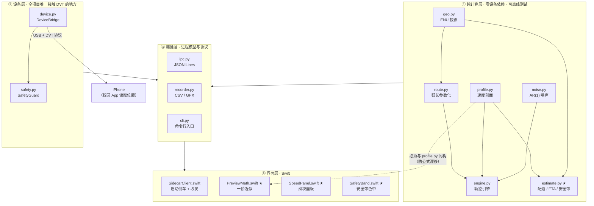
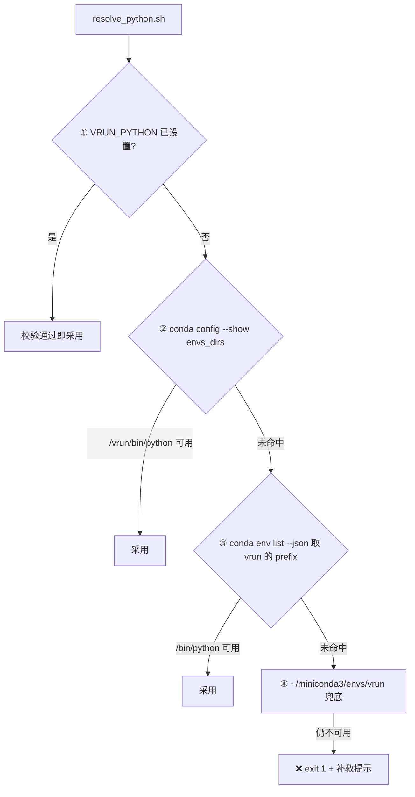

# VRun 代码文件清单（File Manifest）

> **本文定位**：`works.md` §4.4「目录结构」的**展开版**——回答「**哪个文件负责哪一块功能、边界在哪、接口长什么样**」。
>
> - `works.md` 回答「**做什么、为什么这么设计**」（物理约束、架构、面板规格、里程碑）
> - 本文回答「**代码怎么切分、每个文件写什么**」
> - **两者冲突时以 `works.md` 为准**。本文只做细化，不引入新需求。
>
> | 项 | 值 |
> | --- | --- |
> | 版本 | **v2（2026-10-12）** |
> | 对应 `works.md` | v3 |
> | 语言约定 | 代码注释、文档、GUI 文案**一律中文** |
>
> ⚠️ **重要前提（v2 更新）**：本文 v1 写作时仓库内**尚无任何代码文件**，
> 全文描述的都是**待建文件的规格**。**M1 已于 2026-10-11 落地**，
> `src/vrun/` 下 ① 纯计算层 6 个文件 + `cli.py` + 包入口均已实现（209 测试全绿）。
>
> 因此本文现在的地位是：
>
> - **已实现部分**（§4.1、`estimate` / `cli`）= 接口**契约**，改动须与代码同步；
> - **未实现部分**（§4.2 设备层、§5 Swift GUI、`ipc.py` / `recorder.py`）= 仍是**设计约定**。
>
> 接手 Agent 应当**先看仓库里有什么**，再对照本文判断某处是「契约」还是「约定」。

---

## 0. 快速索引

| 你想做什么 | 去哪一节 |
| --- | --- |
| 理解整体分层与切分理由 | §1 §2 |
| 写 Python 轨迹内核 / 估算 | §4.1 |
| 写 iPhone 位置注入 | §4.2 |
| 写协议、落盘、命令行 | §4.3 |
| 写 macOS GUI | §5 |
| 写测试 | §6 |
| 写运维脚本 | §7 |
| 查某文件属于哪个里程碑 | §10 |
| 确认哪些事绝对不能做 | §11 |

**一句话版本**

- 想要「**能离线测的数学**」→ `src/vrun/` 的 ① 纯计算层，6 个文件
- 想要「**能控制手机**」→ `src/vrun/device.py` + `src/vrun/safety.py`
- 想要「**滑块面板**」→ `app/VRun/Sources/VRunApp/` 里带 ★ 的 4 个文件
- 想要「**证明它是对的**」→ `tests/` + `tests/golden/estimate.json`

**规模概览**：全项目共 **49 项 = 48 个文件 + 1 个运行时目录**（详见 §10 交叉表）。

---

## 1. 分层总览

按「**能不能脱离 iPhone 独立验证**」切成四层：



**图里有两个箭头值得单独盯住**

1. `DEV → PHONE`：**全项目唯一**跨出 macOS 的边界，被孤立在 ② 层。所有不确定性与失败模式都集中在这一条线上。
2. `PROFILE ⇢ PM`（虚线）：表示「逻辑上必须同构」——`PreviewMath.swift` 是 `profile.py` 公式的 Swift 镜像，靠 `tests/golden/estimate.json` 强制对齐（works.md §5.6）。虚线而非实线，是因为两者**不通过代码共享**，只通过**基准数据**对齐。

---

## 2. 分层原则（为什么这么切）

判据只有一个：**能不能脱离 iPhone 独立验证**。

| 层 | 判定标准 | 允许的第三方依赖 |
| --- | --- | --- |
| ① 纯计算 | 输入 dict / 输出 dict；不碰 USB、不碰设备、不做进程管理 | 仅 `numpy` |
| ② 设备 | **全项目唯一**允许 `import pymobiledevice3` 的地方 | ① 层 + `pymobiledevice3` |
| ③ 编排 | 进程生命周期、协议编解码、落盘 | ①② |
| ④ 界面 | 只负责显示与交互，不承载业务公式 | Swift 标准库 + MapKit |

**三条硬约束**（违反任意一条，M1 的「无手机开发」就会崩）

1. **① 层不许 `import` ② 层，也不许 `import pymobiledevice3`。**
   否则在没插手机的机器上连单元测试都跑不起来——而 M1 的全部价值就在于「手机不在场也能推进」。
2. **`estimate.py` 与 `engine.py` 必须共用同一个 `SpeedProfile` 类**（works.md §4.3.5）。
   不允许各自实现一套速度公式。这是风险 R-8「预览与实际漂移」的结构性防线。
3. **① 层的随机性只允许来自显式传入的 `numpy.random.Generator`**，禁止使用全局 `np.random.*`。
   理由：全局状态会让「同种子 ⇒ 逐字节可复现」这条验收标准失效（详见 §4.1.4）。

---

## 3. 仓库根目录

| 文件 | 职责 | 里程碑 | 状态 |
| --- | --- | --- | --- |
| `works.md` | 工程文档主文件。另一 Agent 的唯一真相源 | — | ✅ 已存在 |
| `.gitignore` | 忽略规则（见 §3.1） | M0 | ✅ 已存在 |
| `LICENSE` | MIT | — | ✅ 已存在 |
| `requirements.txt` | **pip 层依赖的唯一权威声明** | M0 | ✅ 本轮新增 |
| `environment.yml` | conda 环境 `vrun`（python=3.12；pip 段引用 `requirements.txt`） | M0 | 待建 |
| `README.md` | 从零上手：建环境 → 跑离线测试 → 连手机 → 开 GUI | M5 | 待建 |
| `docs/` | 见 §8 | — | ✅ 本轮新建 |
| `logs/` | 运行记录（**不入库**） | — | 运行时生成 |

### 3.1 `.gitignore` 应覆盖的项

| 类别 | 条目 |
| --- | --- |
| Cyrene 工作底稿 | `.cyrene/` |
| macOS | `.DS_Store` |
| Python | `__pycache__/`、`*.pyc`、`.pytest_cache/`、`*.egg-info/` |
| 虚拟环境 | `venv/`、`.venv/` |
| Swift 构建 | `.build/`、`app/VRun/.build/` |
| 运行产物 | `logs/`、`*.log` |

> `logs/` 不入库是**刻意的**：真实跑动日志会包含博文在校园的坐标轨迹，属于个人位置数据，不应该进版本历史。

---

## 4. Python 侧车 · `src/vrun/`

包名 `vrun`，**13 个文件**。

其中**只有 3 个文件与设备或进程强相关**（`device.py` / `safety.py` / `cli.py`），其余 10 个都能在没手机的机器上完整运行与测试。

### 4.0 包结构与入口

| 文件 | 职责 | 里程碑 |
| --- | --- | --- |
| `src/vrun/__init__.py` | 包声明、`__version__`、对外导出清单 | M1 |
| `src/vrun/__main__.py` | `python -m vrun` 入口 → 转发到 `cli.main()` | M1 |

> `__init__.py` 里**不要** import `device.py`——那会把 `pymobiledevice3` 变成包级强依赖，
> 一旦它没装好，连 `vrun estimate` 都用不了。设备相关一律在 `cli.py` 中**延迟导入**。

---

### 4.1 ① 纯计算层（6 个文件）

> 这一层是**风险最低、价值最高**的部分：不需要 iPhone、不需要 Xcode、不需要联网，
> `pytest` 秒级跑完。**M1 阶段全部可交付。**
> 滑块面板的全部数学逻辑，都能在这一层离线验证完。

#### 4.1.1 `src/vrun/geo.py` — 坐标数学底座

| 项 | 内容 |
| --- | --- |
| **职责** | 经纬度 ↔ 局部 ENU 米制平面的双向投影；haversine 距离；方位角 |
| **为什么存在** | 噪声是**米制**叠加的，而注入接口只吃**经纬度**。中间必须有且只有一次换算，否则误差会在两套单位间反复污染 |
| **依赖** | 仅 `math`（标量运算用标准库更快，numpy 在此无收益） |
| **里程碑** | M1 |

接口约定：

```python
class ENUProjector:
    """以 origin 为原点的局部等距圆柱投影（江安校区尺度误差 < 0.1%）。"""

    def __init__(self, origin_lat: float, origin_lon: float) -> None: ...

    def to_enu(self, lat: float, lon: float) -> tuple[float, float]:
        """经纬度 → (东, 北)，单位米。"""

    def to_latlon(self, e: float, n: float) -> tuple[float, float]:
        """(东, 北) 米 → 经纬度。必须是 to_enu 的严格逆运算。"""


def haversine(lat1: float, lon1: float, lat2: float, lon2: float) -> float:
    """两点大圆距离，单位米。"""


def bearing(lat1: float, lon1: float, lat2: float, lon2: float) -> float:
    """起点指向终点的方位角，单位度；正北为 0，顺时针为正。"""
```

**设计要点**

- 用**等距圆柱（equirectangular）近似**，而非完整大地测量：
  纬度 30.6° 附近、跨度 < 5 km 时相对误差 < 0.1%，比 Vincenty 快两个数量级，且**可闭式反解**。
- `to_enu` / `to_latlon` **必须严格互逆**（往返误差 < 0.1 m），这是 `test_geo.py` 的头号断言。
- 经度方向的尺度因子要乘 `cos(origin_lat)`——这是等距圆柱唯一容易写错的地方。
- 方位角只用于**可选**的调试输出（DVT 不接收 course，见 works.md §1.2），实现可以很简单。

**测试方式**：`tests/test_geo.py`——往返误差、已知两点距离对照、方位角四个象限。

---

#### 4.1.2 `src/vrun/route.py` — 路线模型与弧长参数化

| 项 | 内容 |
| --- | --- |
| **职责** | 折线路线模型；累计弧长表；`point_at(s)` 按弧长取点；按目标距离等比缩放；JSON 读写 |
| **为什么存在** | 引擎只推进一个标量 `s`（弧长），几何细节全部封在这里。这是「速度 = 推进弧长的速率」这一核心设计的落地处（works.md §2.2） |
| **依赖** | `geo.py` |
| **里程碑** | M1 |

接口约定：

```python
class Route:
    points: list[tuple[float, float]]   # [(lat, lon), ...] 折线顶点

    def length(self) -> float:
        """总长度，单位米。"""

    def point_at(self, s: float) -> tuple[float, float, float]:
        """★ 核心接口：弧长 s（米）→ (lat, lon, bearing)。
        s 超出 [0, length] 时钳制到端点。"""

    def scaled_to(self, target_m: float) -> "Route":
        """绕质心等比缩放，使总长等于 target_m（用于把随手画的路线凑成 3 km）。"""

    def to_json(self, path: str) -> None: ...
    @classmethod
    def from_json(cls, path: str) -> "Route": ...
```

**设计要点**

- `point_at(s)` 是**引擎唯一接触几何的入口**。实现：累计距离数组 + `bisect` 二分定位线段 + 线段内线性插值，复杂度 O(log n)。
- 缩放是**等比**的，会同时改变路线的形状尺度；这是可接受的——地图上随手画的路线本来就只是个赛道形状，不要求与真实道路严格对齐。
- JSON 格式要**稳定且向后兼容**（GUI 会写、侧车会读）：建议 `{"version": 1, "points": [[lat, lon], ...]}`。带版本号是为了将来改格式时能识别旧文件。

**测试方式**：`tests/test_route.py`——总长误差 < 0.5%、`point_at(0)` / `point_at(length)` 等于首尾点、`point_at(length/2)` 落在中点附近、缩放后长度正确。

---

#### 4.1.3 `src/vrun/profile.py` — 速度剖面（单一真相源）★

| 项 | 内容 |
| --- | --- |
| **职责** | works.md §3.2 的四段叠加剖面 + §3.3 预设档位 + 硬夹紧 |
| **为什么是 ★** | `engine.py` 与 `estimate.py` **都 import 这一个类**。这是防「预览说 18:09、实际跑 18:40」的结构性保证（风险 R-8） |
| **依赖** | 无第三方（纯标量运算） |
| **里程碑** | M1 |

接口约定：

```python
@dataclass
class SpeedProfile:
    v_bar: float = 10.0          # 目标稳态速度 km/h（由滑块给出）
    t_w: float = 30.0            # 起步 ramp 时长，秒
    r0: float = 0.8              # 起步初速比（0.8 → 从 8 km/h 起）
    delta: float = -0.015        # 疲劳漂移（全程线性）
    finish_frac: float = 0.08    # 终点冲刺区段长度（占总距离比例）
    f: float = 0.05              # 冲刺幅度
    v_floor: float = 6.3         # 硬夹紧下界
    v_ceil: float = 16.7         # 硬夹紧上界
    clamp_enabled: bool = True   # 贴线设定时必须置 False（works.md §3.2 注）

    def speed_at(self, t: float, s: float, total: float) -> float:
        """t = 已用时(s)，s = 已走弧长(m)，total = 总弧长(m) → 目标速度 km/h。"""

    def expected_duration(self, distance_m: float) -> float:
        """对完整剖面数值积分，得到走完全程所需秒数（精确 ETA）。"""


PRESETS: dict[str, float] = {
    "慢跑/快走": 7.0,
    "常规慢跑": 8.5,
    "标准": 10.0,
    "进阶": 12.0,
    "快跑": 14.0,
    "贴近上限": 16.5,
}
```

**设计要点**

- `clamp_enabled` 是**必需的开关**，不是可选优化：滑块允许把 `v̄` 设到 `6.0` 或 `17.0`（贴线测试），
  此时夹紧必须让位，否则测不出边界行为（works.md §3.2 末尾的 ⚠️）。
- ramp 用 `r0 = 0.8` 而非更真实的 0.6：起跑瞬间不会掉到 6 km/h 以下，
  避免「为了真实反而触发过慢判定」。更冒险的 `r0 = 0.6` 留作「冷启动」预设。
- `expected_duration()` 用数值积分（梯形法，步长 ≤ 0.05 s）而非一阶近似——
  它是 §3.6 那个闭式解的**权威版本**，闭式解只供 GUI 拖动时用。
- **禁止**在本文件之外出现第二份速度公式（works.md §11）。

**测试方式**：`tests/test_profile.py`——稳态速度误差 < 1%、clamp 生效、ramp 段不越界、`t_w` 之后回到 `v̄`。

---

#### 4.1.4 `src/vrun/noise.py` — 双层 AR(1) GPS 噪声

| 项 | 内容 |
| --- | --- |
| **职责** | works.md §3.4 的**双层一阶高斯马尔可夫过程**（慢漂移 + 快抖动），东 / 北各一路独立；可选跳点注入 |
| **依赖** | `numpy`（纯计算层里唯一用 numpy 的文件） |
| **里程碑** | M1 |

接口约定：

```python
class AR1:
    """一阶自回归过程：n_{k+1} = ρ·n_k + √(1−ρ²)·σ·ε，其中 ρ = exp(−Δt/τ)。"""

    def __init__(self, sigma: float, tau: float, dt: float,
                 rng: np.random.Generator) -> None: ...

    def step(self) -> float: ...


class GPSNoise:
    """双层噪声：慢漂移(σ=3.0 m, τ=300 s) + 快抖动(σ=0.3 m, τ=1.5 s)，东/北独立。"""

    LEVELS = {"off": 0.0, "realistic": 1.0, "harsh": 1.5}   # 相对基准的缩放系数

    def __init__(self, level: str, sample_rate: float, seed: int,
                 enable_spikes: bool = False) -> None: ...

    def sample(self) -> tuple[float, float]:
        """返回本次采样的 (de, dn)，单位米。"""

    def reset(self) -> None:
        """回到初始状态，使同一种子能重复生成整段轨迹。"""
```

**设计要点（三条，都很关键）**

1. **必须用 `np.random.default_rng(seed)`，禁止 `np.random.seed()` 与全局 `np.random.*`。**
   原因：全局状态会被任何第三方库的随机调用污染，导致「同种子 ⇒ 逐字节可复现」这条验收标准失效。
   `default_rng` 返回独立的 Generator 对象，且 numpy 对 PCG64 的比特流有**跨版本兼容承诺**。
2. **`ρ = exp(−Δt/τ)` 必须按实际 `Δt` 重算，不能缓存常量。**
   采样率从 5 Hz 切到 0.5 Hz 时 ρ 变化极大，缓存会让「切换采样率」这个动作在数值上失真。
3. `LEVELS` 的键是英文（`off` / `realistic` / `harsh`），对应 works.md §3.4 的三个中文档位（关 / 真实 / 严苛）。
   映射表只在这里维护，GUI 只传英文键——避免中文字符串同时散落在 Python 与 Swift 两侧。

**测试方式**：`tests/test_noise.py`——同种子逐字节一致；后验 σ 与自相关符合设定值 ±10%；跳点关闭时不产生离群点。

---

#### 4.1.5 `src/vrun/engine.py` — 轨迹引擎

| 项 | 内容 |
| --- | --- |
| **职责** | 按**真实时钟**积分弧长，按采样率吐出 `(t, lat, lon, s, v)` 序列 |
| **依赖** | `route` / `profile` / `noise` |
| **里程碑** | M1 |

接口约定：

```python
@dataclass
class Sample:
    t: float          # 已用时，秒
    lat: float
    lon: float
    s: float          # 已走弧长，米
    v_target: float   # 剖面给出的目标速度，km/h
    v_actual: float   # 本段实际平均速度，km/h（含噪声位移的影响）


class TrackEngine:
    def __init__(self, route: Route, profile: SpeedProfile,
                 noise: GPSNoise, sample_rate: float) -> None: ...

    def run(self, on_sample: Callable[[Sample], None],
            clock: Callable[[], float] = time.monotonic) -> "RunStats":
        """推进到路线终点；每到一个采样点调用 on_sample。"""

    def simulate_offline(self) -> list[Sample]:
        """★ 注入假时钟，把整段轨迹一次算完（测试用，秒级完成）。"""
```

**★ 关键设计：`clock` 可注入**

| 场景 | 传入的 clock | 效果 |
| --- | --- | --- |
| 真机跑 | `time.monotonic`（默认） | 按真实流逝时间推进 |
| 离线测试 | 「每次调用 +1 s」的假时钟 | **18 分钟的仿真在测试里 0.1 秒跑完** |

没有这个参数，M1 的验收测试（「离线跑 3 km 并统计平均速度」）根本没法做——
总不能每次跑测试都真的等 18 分钟。

**其它要点**

- 积分为 `s += v · Δt`，其中 `Δt` 由 `clock()` 的差值给出。
  **绝不能用固定 dt**：DVT 往返延迟会让固定 dt 与实际时间脱节，速度随之失真（works.md §4.3.1）。
- 每步结束判断 `s ≥ route.length()`：超出的部分**钳制到终点**，不做回退。
- `v_actual` 用「两点间大圆距离 ÷ Δt」计算，**含噪声位移**——它才是 iPhone 侧 App 看到的速度。
  这正是 §3.5「表观速度抖动」在代码里的对应物。

**测试方式**：`tests/test_engine.py`——用假时钟离线跑完 3 km；平均速度误差 < 1%；总距离误差 < 0.5%；
实测 ETA 与 `estimate` 预测差 < 2 s。

---

#### 4.1.6 `src/vrun/estimate.py` — 配速 / ETA / 安全带 ★

| 项 | 内容 |
| --- | --- |
| **职责** | GUI 预览的**权威数值来源**。§3.6 闭式解 + 精确 ETA + §3.5 表观抖动 + §5.3 安全带 + §5.4 golden 表 + R1–R5 判定预期。**纯计算，不碰设备** |
| **为什么是 ★** | `vrun estimate` 不需要设备 ⇒ **滑块面板的全部逻辑在 M1 就能离线验证完** |
| **依赖** | `profile` / `geo` |
| **里程碑** | M1 |

接口约定：

```python
@dataclass
class EstimateResult:
    speed_kmh: float
    distance_m: float
    noise_level: str
    sample_rate: float

    pace_s_per_km: float                      # 配速，秒每公里
    pace_str: str                             # "6:00"
    eta_naive_s: float                        # 纯运动（D / v）
    eta_s: float                              # 修正 ETA（数值积分，**权威**）
    eta_closed_form_s: float                  # 修正 ETA（一阶近似，GUI 拖动用）
    eta_str: str

    sigma_v: float                            # 表观速度抖动 1σ，km/h
    band_1sigma: tuple[float, float] | None   # v̄ 的可行区间，见下方⚠️
    band_2sigma: tuple[float, float] | None   # None = 无安全带（严苛档退化）
    safety: str                               # "green" / "yellow" / "red"（works.md §5.3）
    v_lo: float                               # 本设定下瞬时速度的慢端 = v̄(1+δ) − 2σ
    v_hi: float                               # 本设定下瞬时速度的快端 = v̄(1+f) + 2σ

    verdict: dict[str, str]                   # {"R1": "✓", "R3": "⚠️ 临界", ...}
    clamp_enabled: bool                       # 贴线设定时为 False


def estimate(speed_kmh: float, distance_m: float = 3000.0,
             noise_level: str = "realistic", sample_rate: float = 1.0,
             profile: SpeedProfile | None = None,
             seed: int = 0) -> EstimateResult: ...


def sigma_apparent(dt: float, level: str = "realistic") -> float:
    """works.md §3.5：单轴差分标准差 → 二维位移误差 → 表观速度误差。"""


def safety_band(sigma_v: float, profile: SpeedProfile,
                levels: float = 2.0) -> tuple[float, float] | None:
    """works.md §5.3：返回「levels·σ 内绝不越界」的 **v̄ 区间**；无解返回 **None**。

    ⚠️ **别把它和 `v_lo` / `v_hi` 搞混** —— works.md §5.4 里两种量都出现了：

    | 量 | 含义 | 回答的问题 |
    | --- | --- | --- |
    | `band_2sigma` | **v̄ 的可行区间** | 滑块该停在哪儿才安全？ |
    | `v_lo` / `v_hi` | 某个既定 v̄ 下**瞬时速度**的取值范围 | 现在这个设定会被噪声推到哪？ |

    `levels` 参数是必需的 —— 面板要同时画 1σ（黄）与 2σ（绿）两条带。
"""
```

**两条必须实现的退化路径**（否则会把「真实结论」当成 bug 修掉）

1. **严苛档安全带为空集** → `band_2sigma = None`，附原因文本，**不画绿带**。
   验算：`v̄·0.985 − 6 ≥ 6 ⇒ v̄ ≥ 12.18`，同时 `v̄·1.05 + 6 ≤ 17 ⇒ v̄ ≤ 10.48`，交集为空。
2. **贴线设定（6.0 / 17.0）不阻止** → 正常返回结果，只在 `verdict` 里标 `⚠️`。
   滑块允许越界设定是刻意的（works.md §3.2），工具只负责**如实预警**。

**设计要点**

- `eta_s` **必须调 `profile.expected_duration()`**，不许另写一阶近似。
  这正是 §4.3.5「单一真相源」的落地点。
- `band_2sigma` 的边界要按 §5.3 含 δ 与 f 的公式算，**不能简单用 ±2σ 加减 `v̄`**——
  冲刺抬升与漂移压低会让安全带显著收窄（合法窗口 6–17，但 2σ 安全带只有 10.2–12.4）。
- `verdict` 是**预测**，供实测比对（works.md §5.5）。键名固定为 `R1`…`R5`，与规则一一对应。

**测试方式**：`tests/test_estimate.py`——逐行断言 §5.4 全表（11 行 golden values）；
严苛档返回 `None`；贴线设定不被拒绝。

---

### 4.2 ② 设备层（2 个文件）

> **全项目唯一允许 `import pymobiledevice3` 的地方。**
> M1 完全不需要它，M2 才动。但 `safety.py` 的骨架在 M1 就能用**假 bridge** 写完并单测。

#### 4.2.1 `src/vrun/device.py` — DeviceBridge

| 项 | 内容 |
| --- | --- |
| **职责** | 封装 `pymobiledevice3` 的 `LocationSimulation`：连接 → 挂 DDI → 建隧道 → `set` / `clear` |
| **依赖** | `pymobiledevice3` |
| **里程碑** | M2 |

接口约定：

```python
@dataclass
class DeviceStatus:
    connected: bool
    ddi_mounted: bool
    tunnel_up: bool
    device_name: str | None
    ios_version: str | None
    error: str | None = None


class DeviceBridge:
    async def connect(self) -> None: ...
    async def mount_ddi(self) -> None: ...
    async def start_tunnel(self) -> None: ...

    async def set_location(self, lat: float, lon: float,
                           timeout: float = 2.0) -> None:
        """注入一个坐标。带超时与有限重试。"""

    async def clear(self) -> None:
        """停止模拟。**幂等**：重复调用不报错。"""

    def status(self) -> DeviceStatus: ...
```

**设计要点**

- 上游 CLI 用法（works.md §1.2 已核实）：
  `pymobiledevice3 developer dvt simulate-location {set|clear|play}`；
  Python API 为 `LocationSimulation`（async context manager）。
- **`set_location` 内部不做清理。** 清理是 `SafetyGuard` 的独占职责（见 §4.2.2）——
  两处都管清理必然导致逻辑分叉，而清理逻辑一旦分叉就是安全红线。
- 每次 `set` 带 `timeout`（默认 2 s）与**有限重试**（例如 2 次）。失败必须抛结构化异常，
  **不许静默吞掉**：静默失败会让轨迹出现无声的空洞，而日志上一切正常。

#### 4.2.2 `src/vrun/safety.py` — SafetyGuard（幂等清理）

| 项 | 内容 |
| --- | --- |
| **职责** | works.md §2.3 的**三保险**，全部指向同一个幂等清理动作 |
| **依赖** | `device.py` |
| **里程碑** | M2（**骨架可在 M1 用假 bridge 写完并单测**） |

接口约定：

```python
class SafetyGuard:
    def __init__(self, bridge: DeviceBridge) -> None: ...

    def arm(self) -> None:
        """注册 atexit + SIGINT / SIGTERM 处理器。可重复调用（只生效一次）。"""

    def cleanup(self) -> bool:
        """★ 幂等：第一次真正执行 clear()，之后直接返回 False。
        返回值 True 表示本次调用真的执行了清理。"""

    @property
    def cleaned(self) -> bool: ...
```

**设计要点**

- `_cleaned` 标记位是**本文件的核心**。三保险在某些路径上会重复触发
  （例如 Ctrl-C 同时走 `finally` 与 signal handler），没有幂等保护就会对已清除的设备再发一次 `clear`。
- signal handler 里**只能做最少的事**：置位 + 尽力 `clear()`，然后退出。
  不要在 handler 里做日志 flush、网络请求、复杂异常处理——那些在信号上下文里都不安全。
- **这是全项目最不能出错的文件**：漏了清理，博文的 iPhone 定位会一直卡在校园的虚拟点上，
  导航、天气、「查找」全部跟着偏。

**测试方式**（M1 阶段即可做）：用假 bridge 断言 `cleanup()` 第二次返回 `False`，且 `clear` 只被调用一次。

---

### 4.3 ③ 编排层（4 个文件）

#### 4.3.1 `src/vrun/ipc.py` — JSON Lines 协议

| 项 | 内容 |
| --- | --- |
| **职责** | works.md §4.2 的协议编解码 + 命令分发表 |
| **依赖** | `estimate` / `profile`（**不 import 设备层**） |
| **里程碑** | ✅ **M1 已完成**（`estimate` 分支 + 编解码 + 服务循环）/ ⛔ M2（`run.*` / `device.*` 实装） |

接口约定：

```python
def read_message(stream) -> dict | None:
    """读一行 → dict；EOF 返回 None。空行跳过。"""

def write_message(stream, obj: dict) -> None:
    """写一行 JSON + '\\n' 并 **flush**（不 flush 会让 GUI 看不到实时 tick）。"""

HANDLERS: dict[str, Callable[..., Awaitable[dict]]] = {
    "route.set": ...,      "run.prepare": ...,   "run.start": ...,
    "run.pause": ...,      "run.resume": ...,    "run.stop": ...,
    "device.cleanup": ..., "device.status": ..., "estimate": ...,
}
```

**设计要点**

- **必须每行 flush。** 缓冲会让 `tick` 在管道里攒够 4 KB 才吐出来，
  GUI 上的表现是「按了开始以后两分钟才开始动」——非常难排查。
- 协议是**命令 + 事件**混合，事件不带 id 配对。
  因为同一时刻只可能有一个会话（§5.7 已锁定滑块），天然串行。
- 中文文案要 `ensure_ascii=False`，否则日志里全是 `\uXXXX`，出了问题根本没法读。
- **参数校验要在协议层就转成 `ProtocolError`**。放任 `ValueError` 逃逸会被 `serve()`
  的兜底标成 `internal / 这是侧车的 bug，请反馈` —— 但传错参数是**调用方**的问题，
  标错方向会让人白忙一场。

> **M1 已达成的能力**：滑块面板的**全部数学**现在就能通过 `vrun serve` 端到端跑通，
> **不依赖 iPhone**（works.md §5.7）。`estimate` 是面板唯一的数据源，它通了，
> M3 的 `SpeedPanel` / `PreviewMath` / `SafetyBand` 就有了一个可离线联调的对手方。

#### 4.3.2 `src/vrun/recorder.py` — 落盘

| 项 | 内容 |
| --- | --- |
| **职责** | 把 `Sample` 序列写成 CSV（供统计）与 GPX（供地图复盘） |
| **里程碑** | M1 |

```python
class Recorder:
    def write_csv(self, samples: list[Sample], path: str) -> None: ...
    def write_gpx(self, samples: list[Sample], path: str) -> None: ...


def summarize(samples: list[Sample]) -> dict:
    """平均速度 / 总距离 / 用时 / 表观速度标准差 —— M1 验收要用的统计量。"""
```

- CSV 列顺序固定为 `t,lat,lon,s,v_target,v_actual`，方便 `csv.DictReader` 与肉眼核对。
- `summarize()` 是 M1 验收的**执行者**：验收标准里的「平均速度 ≈ 设定值 ±1%」就靠它算出来。
- 输出默认写 `logs/`（已在 `.gitignore` 中）。

#### 4.3.3 `src/vrun/cli.py` — 命令行入口

| 项 | 内容 |
| --- | --- |
| **职责** | 子命令：离线三件套（`estimate` / `golden` / `simulate`）+ 设备占位（`device-status` / `panic-clear`）+ 侧车入口（`serve`，**M2 待建**） |
| **里程碑** | M1（离线三件套 ✅）/ M2（`serve` + 设备子命令） |

```bash
# ── 已实现（M1，不需要 iPhone）──
vrun estimate --speed 10 --distance 3000      # ★ 单点预览：配速/ETA/安全带/判定
vrun golden                                   # works.md §5.4 基准表全 11 行
vrun simulate --route route.json --speed 10 --csv logs/run.csv

# ── 占位（M2 实现，未实现时 exit 2 并打印可用子命令）──
vrun device-status
vrun panic-clear                              # 手动紧急清除

# ── 待建（M2）──
vrun serve                                    # 启动侧车，JSON Lines 走 stdin/stdout
```

- **`vrun estimate` 不 import `device.py`**（用延迟导入）。
  这是「§5 面板逻辑在 M1 全部可离线验证」的技术前提——在没装 `pymobiledevice3` 的环境里它也必须能跑。
- `serve` 是 GUI 唯一会调用的子命令，依赖 `ipc.py` ✅（M1 已建）。
- 所有子命令都要有中文 `--help`；GUI 崩溃时用户能靠 CLI 自救。

> **⚠️ 与本文 v1 的差异（v2 已对齐实现）**
>
> | 项 | v1 写的 | 实际实现 | 原因 |
> | --- | --- | --- | --- |
> | 子命令名 | `cleanup` | **`panic-clear`** | 它是**紧急**清除（GUI 崩溃后的救援），不是会话收尾；与 `scripts/panic-clear.sh`（works.md §2.3）同名更好记 |
> | 输出参数 | `--out logs/` | **`--csv <路径>`** | 显式指明格式；目录语义会在「CSV 还是 GPX」上产生歧义 |
> | `golden` | 未列 | **已实现** | §5.4 全表是跨语言契约，需要一条命令能直接导出对照 |
>
> **`--distance` 的缺省语义是 `None`，不是 3000**（曾有 bug，见 `tests/test_cli.py`）：
> 给了 `--route` 却没给 `--distance` 时，**保持路线原长**；
> 默认值若取 3000，会把用户画好的路线无声缩放掉。

---

## 5. Swift GUI · `app/VRun/`（11 个文件）

> 采用 **SwiftPM 包**而非 Xcode 工程——这样 `swift build` 单独就能构建，
> 不依赖 Xcode 组件是否装好（这是风险 R-5 的兜底路径）。

| 文件 | 职责 | 里程碑 |
| --- | --- | --- |
| `app/VRun/Package.swift` | SwiftPM 包定义：macOS 平台版本、MapKit 链接、可执行目标 `VRunApp` | M3 |
| `Sources/VRunApp/VRunApp.swift` | `@main` 入口；创建窗口；注入全局状态 | M3 |
| `Sources/VRunApp/RouteCanvas.swift` | `MKMapView` 的 `NSViewRepresentable` 封装：点选画折线、显示总长度、当前位置光标 | M3 |
| `Sources/VRunApp/RouteModel.swift` | 路线点集与编辑（增删点、撤销、按目标距离缩放）；与绘制解耦 | M3 |
| `Sources/VRunApp/SpeedPanel.swift` ★ | works.md §5.1 面板布局：滑块 + 配速 + ETA + 判定预期 + 会话按钮 | M3 |
| `Sources/VRunApp/PreviewMath.swift` ★ | §3.6 闭式解的 Swift 镜像；拖动时 60 fps 即时反馈 | M3 |
| `Sources/VRunApp/SafetyBand.swift` ★ | §5.3 色带绘制（`Canvas`），含「严苛档无安全带」的退化渲染 | M3 |
| `Sources/VRunApp/Models.swift` | IPC 消息的 `Codable` 结构（`Tick` / `EstimateResult` / `Command` …） | M3 |
| `Sources/VRunApp/SessionController.swift` | 会话状态机（空闲→预置→运行→暂停→停止→已清理）；§5.7 的滑块锁定 | M3 |
| `Sources/VRunApp/SidecarClient.swift` | `Process` + `Pipe` 启动侧车；JSON Lines 收发；断线重连 | M3 |
| `app/VRun/bundle/Info.plist` | 应用元信息（Bundle ID / 版本 / 最低系统版本） | M3 |

### 5.1 与 `works.md` §4.4 的差异说明（**重要**）

原 §4.4 只列了 6 个 Swift 文件。**`Models.swift` / `SessionController.swift` / `RouteModel.swift`
是 M3 任务清单实际要求、但原目录树遗漏的**。本轮已同步补入 `works.md` §4.4。

不抽出来的后果很具体：

| 文件 | 若不抽取，会变成什么 |
| --- | --- |
| `RouteModel.swift` | 路线编辑逻辑挤进 `RouteCanvas.swift`，导致「视图」与「数据」互相纠缠，撤销功能几乎写不对 |
| `Models.swift` | `tick` / `estimate.result` 的结构体在 `SidecarClient`、`SpeedPanel`、`SessionController` 各定义一遍，字段名必然漂移 |
| `SessionController.swift` | 会话状态（运行中 / 已清理 / 断线）散落在多个 View 的 `@State` 里，清理逻辑被漏调的概率极高 |

### 5.2 关键约束

- `PreviewMath.swift` **只能**实现 §3.6 的闭式解，且必须与 `tests/golden/estimate.json` 对齐。
  它**不是**第二真相源：松手 250 ms 后仍以侧车 `estimate.result` 为准（§5.6）。
- `SidecarClient` 启动侧车时必须用 python 的**绝对路径**，但该路径
  **一律由 `scripts/resolve_python.sh` 解析**（§7.1），任何地方都不得硬编码。
  两个理由：① conda 不在非交互 shell 的 PATH（works.md §1.3 实测）；
  ② 环境的实际位置由 conda `envs_dirs` 决定，写死必错（findings.md F7）。
- GUI 被强杀时**无法保证清理**。因此 `SessionController` 要在 App **启动时主动发一次
  `device.cleanup`**，把上一次崩溃残留的虚拟定位一并扫掉。

---

## 6. 测试 · `tests/`（11 个文件）

| 文件 | 覆盖内容 | 里程碑 |
| --- | --- | --- |
| `tests/conftest.py` | fixture：临时路线、固定种子、**假时钟**、假 bridge | M1 |
| `tests/test_geo.py` | 投影往返误差 < 0.1 m；haversine 对照已知值；方位角四象限 | M1 |
| `tests/test_route.py` | 总长误差 < 0.5%；`point_at` 端点与中点；缩放正确性 | M1 |
| `tests/test_profile.py` | 稳态速度误差 < 1%；clamp 生效；ramp 段不越界；`clamp_enabled=False` 时贴线 | M1 |
| `tests/test_noise.py` | 同种子**逐字节一致**；后验 σ 与自相关符合设定 ±10%；跳点开关 | M1 |
| `tests/test_engine.py` | **假时钟离线跑完 3 km**；平均速度 ±1%；总距离 ±0.5%；**`reset()` 与 `run()` 的语义分工** | M1 |
| `tests/test_estimate.py` ★ | §5.4 golden 全表逐行断言；严苛档返回 `None`；贴线不阻止 | M1 |
| `tests/test_cli.py` | `--distance` 的**缺省语义**（路线不被无声缩放）；设备子命令未实现时的降级路径 | M1 |
| `tests/test_ipc.py` | 协议编解码（flush / 中文不转义）；`estimate` 分支不 import 设备层；坏消息不杀服务循环；**真起子进程的端到端** | M1 |
| `tests/golden/estimate.json` ★ | §5.4 全表基准数据，**pytest 与 Swift 单测共用** | M1 |
| `tests/test_env_resolution.py` | F7 回归：解出的解释器可用 / 版本 3.12 / 含项目依赖；环境名不存在时**报错而非静默回落** | M0 |

### 6.1 关于 `golden/estimate.json`

- 它是**跨语言契约**：Python 侧 `test_estimate.py` 与 Swift 侧 `PreviewMath` 的单测都读它。
  **两边都通过，才说明「预览与实际一致」不是巧合。**
- 它是**唯一允许手工维护的数值表**（来源是 works.md §5.4）。
  除此之外的任何期望值都应该由代码生成，不得手抄——手抄的数字会随代码演进而静默过期。

---

## 7. 脚本 · `scripts/`（5 个）

| 文件 | 职责 | 里程碑 |
| --- | --- | --- |
| `scripts/resolve_python.sh` ★ | **解释器路径的唯一入口**（F7）：`$VRUN_PYTHON` → `envs_dirs` 探测 → `conda env list --json` → 约定位置兜底 | M0 |
| `scripts/bootstrap_env.sh` | 用 conda 全路径建 `vrun` 环境（python=3.12）并 `pip install -r requirements.txt` | M0 |
| `scripts/preflight.sh` | 设备前置检查自动化：连接 / DDI / 隧道 / 探针就绪状态 | M0 |
| `scripts/panic-clear.sh` | **紧急清除**：GUI 崩溃或进程被杀后，一条命令恢复定位 | M2 |
| `scripts/build_app.sh` | `swift build -c release` → 组装 `VRun.app`（Info.plist + 图标） | M5 |

**所有脚本的头部必须包含**：

```bash
# ⚠️ conda 不在非交互 shell 的 PATH，必须用全路径
CONDA=/Users/yuanjun/miniconda3/bin/conda
```

这条备忘在 works.md §1.3 已实测确认（`command -v conda` 为空）。

**但它只覆盖 conda 本体。解释器另有一条更硬的规则（F7）：**

> ❌ 不许写 `/Users/yuanjun/miniconda3/envs/vrun/bin/python`
> ✅ 一律 `PY="$(scripts/resolve_python.sh)"`

两者**刻意区别对待**：`~/miniconda3` 是安装位，不会自己挪；
而**环境**的位置由 `conda config` 的 `envs_dirs` 决定，本机就落在 `~/.conda/envs`。
稳定性不同，不该一刀切。

### 7.1 `resolve_python.sh`：解释器路径的唯一入口（F7 的产物）

findings.md F7 查明：原先文档里硬编码的解释器路径在本机**根本不存在**，
Swift 侧车一启动就会失败。修正后，解释器路径**只有一个来源**。



**三条设计纪律**：

| 纪律 | 为什么 |
| --- | --- |
| 候选须过「存在 + 可执行 + 是 Python 3」三关 | 挡住「目录还在但环境已坏」与「指到非 Python 文件」；否则失败会推迟到侧车启动才暴露 |
| 环境名找不到时**报错退出**，绝不回落 | 静默换一个解释器比直接失败危险得多 —— 它会用错环境跑出「看起来正常」的轨迹 |
| stdout 只输出一行路径，诊断走 stderr | 保证 `PY=$(scripts/resolve_python.sh)` 可安全用于命令替换 |

> **回归护栏**：`tests/test_env_resolution.py`（§6）。
> 它断言的不是某个固定字符串 —— 那本身就是硬编码 —— 而是
> 「解出的解释器确实可用、且确实是本项目的那一个」。

---

## 8. 文档 · `docs/`（3 个文件）

| 文件 | 内容 | 里程碑 |
| --- | --- | --- |
| `docs/preflight.md` | M0 每一步的**实测命令与真实输出**（是记录，不是计划） | M0 |
| `docs/findings.md` | §7.2 冒烟验证结果 + R1–R5 规则的实测对照 | M4 |
| `docs/file-manifest.md` | 本文件 | 本轮 |

> `.cyrene/docs/plan-*.md` 是 Cyrene 的本地工作底稿，**已在 `.gitignore` 中，不入库**。
> 仓库内关于「做什么」的正式文档只有 `works.md` 一份，关于「怎么切分」的只有本文一份。

---

## 9. 依赖策略

### 9.1 两个依赖文件的分工（**必须这样分工，否则必然漂移**）

```
environment.yml            ← conda 层：python 版本、conda 包
   └── pip:
        └── -r requirements.txt    ← pip 层：唯一权威的 pip 依赖清单
```

| 文件 | 角色 |
| --- | --- |
| `requirements.txt` | **pip 依赖的唯一权威。** 任何 Python 依赖只在增删这一处 |
| `environment.yml` | **只能引用它**，不重复列举 pip 包 |

这样 `pip install -r requirements.txt` 与 `conda env create -f environment.yml` 的结果必然一致。

### 9.2 `requirements.txt` 的内容与理由

| 依赖 | 用途 | 归属层 | 备注 |
| --- | --- | --- | --- |
| `pymobiledevice3>=11.26.0` | DVT 位置模拟（iOS 17+ 隧道） | ② 设备层 | works.md §1.2 已核实版本 |
| `numpy>=1.26,<3` | AR(1) 噪声、数值积分、统计校验 | ① 纯计算层 | 本地跑 conda 独立虚拟环境，故允许引入 |
| `pytest>=8.0` | 测试运行器 | 测试 | 仅开发期需要 |

**numpy 的使用纪律**（这不是洁癖，是验收标准的技术前提）

1. **只允许 `np.random.default_rng(seed)`**，禁止 `np.random.seed()` 与全局 `np.random.*`。
2. numpy 对 PCG64 的比特流有**跨版本兼容承诺**，所以 golden values 在不同 numpy 版本上仍可复现。
   若改用全局随机状态，这条保证立刻失效。
3. ① 纯计算层**只能**引入 numpy 这一个第三方库；再多一个，就要重新讨论分层。
4. 设备层只加 `pymobiledevice3`。**不引入 brew / uv / pipx**（works.md §11）。

---

## 10. 文件 ↔ 里程碑 交叉表

| 里程碑 | 文件 | 数量 | 需要 iPhone？ |
| --- | --- | --- | --- |
| **既有** | `works.md`、`LICENSE` | 2 | — |
| **M0** 环境与生死验证 | `requirements.txt`、`environment.yml`、`scripts/bootstrap_env.sh`、`scripts/preflight.sh`、`probe/ProbeApp.swift`、`.gitignore` | 6 | ✅ |
| **M1** 轨迹内核与估算 | ① 纯计算层 6 + `ipc.py` + `recorder.py` + `cli.py` + `__init__.py` + `__main__.py` + `tests/` 10 | 21 | ❌ |
| **M2** 设备桥 | `device.py`、`safety.py`、`scripts/panic-clear.sh` | 3 | ✅ |
| **M3** macOS GUI | `app/VRun/` 全部 | 11 | ❌（可对假数据离线调试） |
| **M4** 冒烟验证 | `docs/findings.md` | 1 | ✅ |
| **M5** 打包与文档 | `README.md`、`scripts/build_app.sh` | 2 | ❌ |
| **文档（跨阶段）** | `docs/preflight.md`（M0 产出）、`docs/file-manifest.md`（本轮） | 2 | — |
| **运行时** | `logs/`（**不入库**） | 1 | — |
| **合计** | | **49** | |

> **49 项 = 48 个文件 + 1 个运行时目录。**
> 其中 **M1 的 19 项完全不需要 iPhone**，是风险最低、价值最高的部分。

---

## 11. 关键设计约束（违反即为 bug）

以下每条都在 `works.md` 有出处，这里只做**可执行的收敛版**，写代码时对照用。

| # | 约束 | 出处 | 怎么检查 |
| --- | --- | --- | --- |
| C1 | ① 层不得 import ② 层或 `pymobiledevice3` | §2 | `grep -rn pymobiledevice3 src/vrun/` 只应命中 `device` / `safety` / `cli` |
| C2 | `set` 必须由 `SafetyGuard` 包裹，清理幂等 | §2.3 | 假 bridge 单测：`cleanup()` 第二次返回 `False` |
| C3 | 不伪造时间戳；速度只能靠推进弧长 | §2.1 | 代码里不存在任何「一次大量推进」的路径 |
| C4 | 采样率默认 1 Hz，**不是越高越好** | §3.5 | 允许 5 / 2 / 1 / 0.5，但默认值必须是 `1.0` |
| C5 | `estimate` 与 `engine` 共用 `SpeedProfile` | §4.3.5 | 全仓只有一份 `speed_at` / `expected_duration` |
| C6 | 噪声用 `default_rng(seed)`，禁全局随机 | §9.2 | `grep -rn "np\.random\.seed"` 应为空 |
| C7 | 每行 IPC 必须 flush | §4.2 | 假管道测试：写入后立刻可读 |
| C8 | `vrun estimate` 不依赖设备 | §4.2 / §5.7 | 在没装 `pymobiledevice3` 的环境里跑通 |
| C9 | 中文文案用 `ensure_ascii=False` | — | 日志可读性 |
| C10 | 不引入 brew / uv / pipx | §11 | 依赖只走 conda + pip |

---

## 12. 变更记录

| 日期 | 版本 | 变更 |
| --- | --- | --- |
| 2026-10-11 | v1 | 首版。作为 `works.md` §4.4 的展开版；补入 `Models.swift` / `SessionController.swift` / `RouteModel.swift` 与 `requirements.txt`；明确 numpy 使用纪律与两个依赖文件的分工 |
| 2026-10-12 | v2.1 | **`ipc.py` 与 `recorder.py` 落地**（M1 全部完成）：① `ipc.py` 标注为 M1 已完成，补充「参数校验须在协议层转成 `ProtocolError`」的设计要点；② `recorder.py` 补充 GPX 回放用途；③ 新增 `tests/test_ipc.py`（含真起子进程的端到端）；④ 测试文件数 10 → 11，规模计数 48 → 49 |
| 2026-10-12 | v2 | **与 M1 的实现对齐**（代码审查后）：① `EstimateResult` 补齐 `safety` / `v_lo` / `v_hi` / `clamp_enabled` 等 GUI 必需字段；② `safety_band` 签名改为 `(sigma_v, profile, levels)` 并返回 `None`（非 `(None, None)`），同时写明它与 `v_lo`/`v_hi` 的区别；③ CLI 子命令清单对齐实现（`panic-clear`、`--csv`、新增 `golden`，`serve` 标为待建）；④ 补 `tests/test_cli.py`；⑤ 规模计数 47 → 48；⑥ 抬头的前提声明改为「M1 已落地」 |
