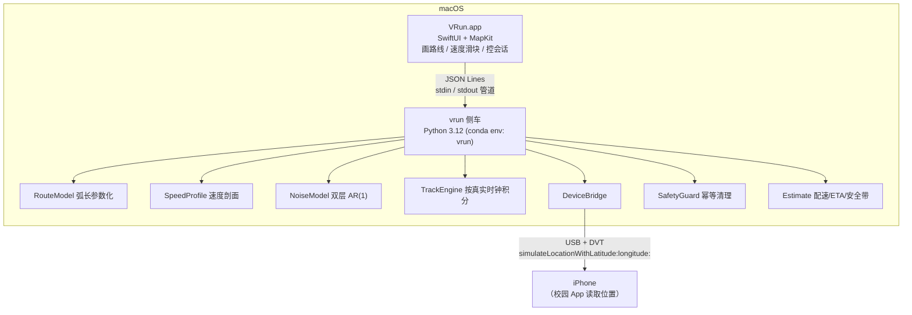

# VRun — iPhone 位置模拟器（校园跑步 App 测试工具）

> 本文件即项目根目录 `works.md`（2026-10-09 落地）。
> 代码注释、文档、GUI 文案**一律中文**。
> 目标读者：用户审阅 + 后续接手的 Agent。

**v2 修订（2026-10-09）**

- ❌ **取消预设测试矩阵**（原 §6 的 9 场景 + Tier 分层 → 删除）。理由见 §7.1。
- ✅ **新增 §5「参数面板：速度滑块与即时预览」**，作为本轮的核心交付。
- ✅ §3.6 新增配速 / ETA 的闭式解（预览计算的规格基础）。
- ✅ §4.2 协议新增 `estimate` / `estimate.result`。
- ✅ M4 从「场景库与实测」收敛为「冒烟验证与实测记录」。

**v3 修订（2026-10-11）**

- ✅ §4.4 目录结构补全：新增 `requirements.txt`、`docs/file-manifest.md`、`probe/`，
  以及 3 个被 M3 任务清单要求、但原目录树遗漏的 Swift 文件（`Models` / `SessionController` / `RouteModel`）。
- ✅ **新增 §4.5「依赖策略」**：明确 `requirements.txt` 与 `environment.yml` 的分工，以及 numpy 的使用纪律。
- ✅ 新增 **`docs/file-manifest.md`**：§4.4 的展开版，逐文件说明职责、接口与里程碑，供接手 Agent 使用。
- ✅ §11 禁止项补充：纯计算层不得引入 numpy 之外的第三方库；不得使用全局随机状态。

---

## 0. 目标

在 macOS 上做一个工具：用 **Apple MapKit** 画一条校园路线，驱动 **iPhone 的定位服务**沿该路线"自动跑步"，速度、里程、GPS 抖动可调 —— 让博文在不真跑 3 公里的前提下，验证校园跑步 App 的计数与判定逻辑。

**核心交互**：一个速度滑块，范围就是规则的合法窗口 **[6, 17] km/h**，拖动时实时预览**配速**、**ETA**、以及**该设定在 GPS 噪声下是否会被误判**。

**交付物**

| 产物 | 内容 |
| --- | --- |
| `VRun.app` | macOS 原生 GUI（SwiftUI + MapKit）：画路线、**速度滑块面板**、控会话 |
| `vrun` 侧车 | Python 3.12 服务：轨迹生成内核 + 参数估算 + iPhone 定位注入 |
| `works.md` | 工程文档，另一个 Agent 可据此独立接手 |
| `docs/file-manifest.md` | 逐文件职责清单（§4.4 的展开版） |
| `docs/findings.md` | 实测记录 |

**明确不在范围内**

- 不分析、不反编译、不 hook 校园 App（用户明确要求，此 App 视为**黑盒**）
- 不做多人 / 多设备坐标比对（Q4 已确认）
- 不伪造时间戳（物理上不可行，见 §2.1）
- **不做预设的规则边界测试矩阵**（见 §7 的替代方案）

---

## 1. 已确认事实

### 1.1 校园 App 的规则（用户口述，作为唯一期望来源）

| 编号 | 规则 | 含义 |
| --- | --- | --- |
| R1 | 每次有效距离 **不少于 3 公里** | 3 km 是下限 |
| R2 | 每次最大锻炼距离 **15 公里** | 15 km 是上限 |
| R3 | 最低速度 **不低于 6 km/h** | 速度下限（= 配速 10:00 /km） |
| R4 | 最高速度 **不超过 17 km/h** | 速度上限（= 配速 3:32 /km） |
| R5 | 每次最长锻炼时间 **不超过 2 小时** | 时长上限 |

**合法速度窗口 `W = [6, 17] km/h`**，宽度 11 km/h。这个窗口是 §5 滑块的定义域。

**仍无定论（不阻塞设计）**：R2 超过 15 km 时是"截断计数"还是"整单判无效"；R5 超过 2 h 的行为。这些由**实测观察**记录，本工具不做断言。

### 1.2 已核实的技术事实（pymobiledevice3 源码 / 官方文档）

| 事实 | 证据 | 置信度 |
| --- | --- | --- |
| 位置模拟命令为 `pymobiledevice3 developer dvt simulate-location {set\|clear\|play}`（iOS 17+） | `cli/developer/dvt/simulate_location.py` | 高 |
| Python API：`LocationSimulation.set(latitude, longitude)` / `clear()`，async context manager | `services/dvt/instruments/location_simulation.py` | 高 |
| 底层 selector：`simulateLocationWithLatitude:longitude:` / `stopLocationSimulation` | 同上 | 高 |
| **`set()` 只接受经纬度，不支持 speed / course / altitude / timestamp** | 维护者原话（issue #340） | 高 |
| `play_gpx_file()` 本质是"按时间戳 sleep 后循环 `set()`"，可仿此自写循环 | `location_simulation_base.py` | 高 |
| iOS 17+ 必须走隧道；macOS 上默认自动建立 in-process userspace 隧道，**无需 root** | 官方 installation 文档 | 高 |
| DDI 由 `mounter auto-mount` / `cryptex auto-install` 自动下载缓存到 `~/.pymobiledevice3`，**不需要 Xcode** | 官方 cli-recipes 文档 | 高 |
| iOS 26.4+ 的 DDI 以 cryptex 形式安装 | 官方文档 + issue #1991 | 高 |
| 最新版 `11.26.0`，`requires_python >= 3.9` | PyPI | 高 |
| 注入不携带 course / speed，轨迹是**离散点跳变** | 维护者说明（issue #340） | 中 |
| `clear` 后个别人反馈定位短时间内不准 | issue #572 评论 | 低（个例） |

### 1.3 本机环境实测（2026-10-09，非推测）

| 项 | 实测结果 | 影响 |
| --- | --- | --- |
| macOS | 27.0.1 (26A434)，arm64 | — |
| conda | `/Users/yuanjun/miniconda3`，conda 26.1.0；base 为 Python 3.13.11 | 建环境用全路径调用 |
| **conda 不在非交互 shell 的 PATH** | `command -v conda` 为空 | ⚠️ 脚本必须写 `/Users/yuanjun/miniconda3/bin/conda` 或 `conda run` |
| Python 3.12 包 | **已缓存在本地** `~/miniconda3/pkgs/python-3.12.13`、`3.12.14` | 建环境**可能无需联网** |
| 现有 env | NetworkProjects / USMDecrypt / azureTest / dataAnalyst / qwen3-asr 均为 3.12.x | 不共用，新建独立 env |
| Xcode | `/Applications/Xcode.app` **存在**，但 `xcode-select -p` 指向 `/Library/Developer/CommandLineTools`；`xcodebuild` 报 "requires Xcode" | ⚠️ 需切开发者目录 + 装组件 |
| CLT SDK | 已含 `MacOSX27.0.sdk` / `MacOSX27.sdk` | 兜底：CLT 就能编 SwiftUI + MapKit |
| Swift | 6.4，target `arm64-apple-macosx27.0.0` | 可用 |
| brew / uv / pipx | **全部缺失** | 不引入；只用 conda + 系统 git |
| pymobiledevice3 | 未安装 | M0 装 |
| 工作区 | 根目录仅 `.cyrene/`、`.gitignore`、`.DS_Store`；`.cyrene/docs/plan-*.md` 为计划文件；非 Git 仓库 | 干净起点 |

---

## 2. 核心约束与推论（整个方案的基石）

### 2.1 时间不可伪造 —— 速度只能靠"移动速率"制造

DVT 协议注入的是**一个坐标**，不携带时间戳。iPhone 侧 App 拿到的 `CLLocation.timestamp` 永远是**投递那一刻的系统时间**。

因此 App 算出的速度必然等于：

```
v_app = |P(t₂) − P(t₁)| / (t₂ − t₁)     ← t 是真实流逝时间
```

**推论（决定性）**：无法"快进"。要让 App 看到 10 km/h，就必须让坐标以 10 km/h 对应的速率真实推进。
→ 想缩短 3 公里测试，唯一合法手段是**用更高但合法的配速**（17 km/h → 10 分 42 秒跑完 3 km），而不是把点喂快。

### 2.2 `set()` 没有速度语义（已由源码证实）

`simulateLocationWithLatitude:longitude:` 只有两个参数。
→ **速度 = 我们推进弧长的速率**。这是设计核心，不是实现细节。

### 2.3 `clear` 是安全红线

注入的位置会**一直保持**，直到显式清除或设备重连。程序异常退出而没清理，iPhone 的定位会"卡"在校园那个虚拟点上，导航 / 天气 / 查找全部跟着偏。

**三保险**（全部指向同一个幂等清理动作，按此顺序）：

1. `try/finally` —— 正常与异常路径
2. `atexit.register()` —— 解释器正常退出
3. `signal` 处理 `SIGINT` / `SIGTERM` —— Ctrl-C 与 kill

另外提供 `scripts/panic-clear.sh`：一条命令强制清除，用于 GUI 崩溃后的救援。

### 2.4 仿真时间 = 真实时间（成本真相）

因为 §2.1，一次"3 公里 10 km/h"的测试要**真实占用 18 分钟**。这是本方案最重要的成本约束 —— 也是 §5 滑块存在的根本原因：

> **能在拖动滑块那一秒看清的事，不应该用 18 分钟的真机跑动去发现。**

---

## 3. 真实跑者模型（对应 Q3）

### 3.1 单位换算（窗口 6–17 km/h）

| km/h | m/s | 配速 min/km | 3 km 纯运动用时 |
| --- | --- | --- | --- |
| 6 | 1.667 | 10:00 | 30:00 |
| 7 | 1.944 | 8:34 | 25:43 |
| 8 | 2.222 | 7:30 | 22:30 |
| 9 | 2.500 | 6:40 | 20:00 |
| 10 | 2.778 | 6:00 | 18:00 |
| 11 | 3.056 | 5:27 | 16:22 |
| 12 | 3.333 | 5:00 | 15:00 |
| 13 | 3.611 | 4:37 | 13:51 |
| 14 | 3.889 | 4:17 | 12:51 |
| 15 | 4.167 | 4:00 | 12:00 |
| 16 | 4.444 | 3:45 | 11:15 |
| 17 | 4.722 | 3:32 | 10:42 |

### 3.2 速度剖面 `v(t)`

真实的人不会匀速跑完 3 公里。模型由 4 段叠加：

```
v(t) = clamp( v̄ · ramp(t) · drift(t) · finish(t) + η(t),  v_floor, v_ceil )
```

| 分量 | 含义 | 默认值 |
| --- | --- | --- |
| `v̄` | 目标稳态速度 | 10.0 km/h（由 §5 滑块给出） |
| `ramp(t)` | 起步加速：前 `t_w` 秒从 `r₀` 线性升到 1 | `t_w = 30 s`，`r₀ = 0.8`（→ 8 升到 10 km/h） |
| `drift(t)` | 疲劳漂移：全程线性 | `δ = −1.5%`（可设正分裂为 +） |
| `finish(t)` | 终点冲刺：最后 8% 距离线性抬升 | `f = +5%`（可关） |
| `η(t)` | 呼吸 / 路况引起的速度波动，AR(1) 相关噪声 | `σ_v = 0.35 km/h`，`τ_v = 10 s` |
| `v_floor / v_ceil` | 速度硬夹紧 | `6.3 / 16.7`（留 0.3 余量防噪声顶出窗口） |

> `ramp` 的 `r₀ = 0.8` 是刻意选的：起跑瞬间不会掉到 6 km/h 以下，避免"为了真实反而触发过慢判定"。需要更真实但更冒险的起步，可用 `r₀ = 0.6` 的"冷启动"预设。

**⚠️ 夹紧值与贴线设定的关系**：夹紧仅用于防止**剖面本身**把速度推出窗口。但 §5 的滑块允许把 `v̄` 设到 6.0 或 17.0（贴线），此时夹紧不再生效 —— **这是刻意的**，因为贴线正是要测的情形。滑块不阻止越界设定，只负责**如实预警**。

### 3.3 预设档位（滑块的吸附点）

| 预设 | `v̄` | 说明 | 3 km（修正后） |
| --- | --- | --- | --- |
| 慢跑 / 快走 | 7.0 | 新手、伤后恢复 | 25:45 |
| 常规慢跑 | 8.5 | 多数学生 | 21:12 |
| **标准（默认）** | **10.0** | 业余常跑 | **18:09** |
| 进阶 | 12.0 | 有训练习惯 | 15:08 |
| 快跑 | 14.0 | 校队水平 | 12:59 |
| 贴近上限 | 16.5 | 压测上限判定 | 11:01 |

### 3.4 GPS 噪声模型（"随机小偏移"）

用**双层 AR(1) 一阶高斯马尔可夫过程**（东 / 北各一路独立分量）。**不用白噪声** —— 白噪声产生锯齿状毛刺，一眼假；真实 GPS 误差在时间上强相关。

| 分量 | 物理来源 | 幅度 `σ` | 相关时间 `τ` |
| --- | --- | --- | --- |
| 慢漂移 | 卫星几何 / 电离层 / 多径长期项 | 3.0 m / 轴 | 300 s |
| 快抖动 | 接收机热噪声 | 0.3 m / 轴 | 1.5 s |
| 跳点（可选，默认关） | 隧道 / 高架 / 城市峡谷 | 概率 1/180 s，幅度 8–25 m | 衰减 τ = 2 s |

递推：`n_{k+1} = ρ·n_k + √(1−ρ²)·σ·ε`，`ρ = exp(−Δt/τ)`；种子固定 ⇒ **完全可复现**。

**噪声档位（三档，用于 §5 面板）**

| 档位 | 含义 | 相对基准 |
| --- | --- | --- |
| `关` | 无噪声（理想条件对照） | σ = 0 |
| `真实`（默认） | §3.4 基准参数 | σ = 1.0× |
| `严苛` | 模拟树荫 / 楼宇遮挡 / 城市峡谷 | σ = 1.5× |

### 3.5 ⚠️ 表观速度抖动（本方案最容易被忽略的坑）

App 若用**朴素前后差分**算速度，GPS 噪声会直接放大成"表观速度抖动"：

```
单轴一阶差分标准差   dᵢ = σᵢ · √( 2(1 − exp(−Δt/τᵢ)) )
二维位移误差         D  = √2 · √( d_slow² + d_fast² )
表观速度误差         Δv = D / Δt
```

代入默认噪声参数：

| 采样间隔 | 速率 | 表观速度 1σ |
| --- | --- | --- |
| 0.2 s | 5 Hz | **4.7 km/h** |
| 0.5 s | 2 Hz | 2.9 km/h |
| **1.0 s** | **1 Hz** | **2.0 km/h** |
| 2.0 s | 0.5 Hz | 1.3 km/h |
| 5.0 s | 0.2 Hz | 0.70 km/h |

**反直觉但重要的结论：采样率越高，朴素差分的速度噪声越大（∝ 1/√Δt）。**
所以默认 **1 Hz**（与 iOS 定位更新频率一致、也最真实），**不是越快越好**。

**刻度感**：规则窗口宽 11 km/h。真实档 2σ = 4.0 km/h，占窗口 **36%**；严苛档 2σ = 6.0 km/h，占 **55%** —— 也就是说**噪声足以吃掉半个合法窗口**。这正是滑块必须显示安全带的原因。

> ⚠️ **口径声明**：以上 σ 建立在"App 使用朴素差分"的假设上。若校园 App 用了卡尔曼滤波 / 移动平均，实际抖动会明显更小、安全带更宽。该策略**未知且不在范围内**（不逆向 App），所以安全带是**保守估计**，需由 §7 的冒烟检查用实测校正。

### 3.6 ★ 配速 / ETA 的闭式解（预览计算的规格）

这是 §5 面板的计算基础。**必须精确到秒**，因为 3 km 尺度下 10 秒误差就是 1%。

设目标速度 `v̄`（km/h）、目标距离 `D`（m）：

```
配速            p = 3600 / v̄                       [s/km]  → 格式化为 mm:ss
纯运动时间      T_raw = D / (v̄ / 3.6)              [s]
```

**修正项**（一阶近似，默认参数）：

| 项 | 来源 | 公式 | 默认值下的影响（3 km @ 10 km/h） |
| --- | --- | --- | --- |
| 起步欠账 | ramp 段速度偏低，少走的距离需补回 | `+ t_w · (1 − r₀) / 2` | **+3.0 s** |
| 疲劳漂移 | 全程线性减速 | `+ T_raw · |δ| / 2` | **+8.1 s** |
| 终点冲刺 | 最后 8% 距离抬升 | `− 0.04 · f · T_raw` | **−2.2 s** |

```
修正 ETA：T ≈ T_raw · (1 + |δ|/2 − 0.04·f) + t_w·(1 − r₀)/2
```

**默认参数下净修正 ≈ +9 s**：朴素算出的 `18:00` 实际是 **`18:09`**（+0.8%）。

> **为什么非算不可**：0.8% 看起来可以忽略，但在 3 km 精度测试里就是 9 秒。如果预览说 18:00 而实际跑了 18:09，用户会误以为是引擎有问题。**预览必须诚实。**
>
> **权威值来自侧车**：上式是一阶近似，仅供 GUI 拖动时即时反馈。精确值由侧车 `estimate.py` 对完整剖面数值积分（含噪声、种子固定）给出。两者差异 > 1 s 时 GUI 高亮提示 —— 这本身就是一道自检（见 §5.6）。

---

## 4. 系统架构

### 4.1 组件图



**为什么拆两边**：DVT / lockdown 那套私有协议在 Swift 里没有成熟开源实现，自己啃 usbmux + RemoteXPC + SSL 是无底洞；`pymobiledevice3` 已经走通。而且 Python 侧能**完全脱离 GUI 与手机独立调试**——这条生死线不该和界面 bug 混在一起。

**为什么用 stdio 管道而不是 UNIX socket**：GUI 用 `Process` 启动侧车，JSON Lines 走 stdin/stdout。少一个 socket 文件、少一层权限问题、生命周期天然绑定（GUI 退出 → 管道断开 → 侧车感知 → 自动清理）。

**为什么不用 CLI 子进程逐点注入**：CLI 每次启动开销 300–800 ms，1 Hz 都稳不住。必须用**常驻进程的 Python API**。

### 4.2 通信协议（JSON Lines，一行一条）

**GUI → 侧车**

| 命令 | 载荷 |
| --- | --- |
| `route.set` | `points: [[lat, lon], …]` |
| `run.prepare` | 把手机定位预置到路线起点，静置等待 |
| `run.start` | `profile: {预设/自定义参数, 噪声档位, 采样率, 目标距离}` |
| `run.pause` / `run.resume` | — |
| `run.stop` | 停止推进，保持在终点 |
| `device.cleanup` | 显式清除模拟定位 |
| `device.status` | 连接 / DDI / 隧道 状态查询 |
| **`estimate`** ★ | `{speed, distance, noise, sample_rate, profile, seed}`（不需连接设备） |

**侧车 → GUI**

| 事件 | 载荷 |
| --- | --- |
| `tick` | `t, lat, lon, s, v_target, v_actual` |
| `progress` | `距离, 用时, 瞬时速度, sigma_v` |
| `device` | `connected / ddi_mounted / streaming / error` |
| `error` | `code, message, hint` |
| **`estimate.result`** ★ | `{pace_s_per_km, pace_str, eta_s, eta_naive_s, sigma_v, band_2sigma:[lo,hi], band_1sigma:[lo,hi], verdict}` |

> `estimate` 是**纯计算**，不触碰设备 —— 所以 GUI 在没连 iPhone 时也能完整使用滑块面板。这一点对 §5 的开发与自测很重要。

### 4.3 关键实现要点

1. **按真实时钟积分，不用固定 dt**
   `s(t) = ∫v dt`，用 `time.monotonic()` 计算实际经过时间。DVT 往返延迟不会扭曲速度。
2. **会话开始前预置位置**
   先 `set` 到路线起点，静置 10–20 s，**再由用户在 App 里开始跑步**。这样"瞬移到起点"这一次跳变不会落在 App 的会话窗口内。
3. **幂等清理**：见 §2.3。
4. **异常恢复**：USB 掉线 / 设备锁屏 / DDI 卸载 → 明确报错 + 可重试，不静默失败。
5. **估算与引擎共用同一份剖面实现**
   `estimate.py` 与 `engine.py` **必须调用同一个 `SpeedProfile` 类**，不允许各自实现一套公式。这是防止"预览说 18:09、实际跑 18:40"这类事故的结构性保证。

### 4.4 目录结构

```
Virtual_Location_Software_For_Apple/
├── works.md                    # 本计划（工程文档）
├── README.md                   # 从零上手
├── .gitignore
├── LICENSE                      # MIT
├── requirements.txt             # pip 依赖（唯一权威，见 §4.5）
├── environment.yml              # conda env: vrun，python=3.12（pip 段引用 requirements.txt）
├── src/vrun/
│   ├── __init__.py             # 包声明（不 import 设备层，保证 estimate 离线可用）
│   ├── __main__.py             # python -m vrun 入口
│   ├── geo.py                  # 经纬度 ↔ 局部 ENU 米制平面、haversine、方位角
│   ├── route.py                # 路线模型 + 弧长参数化 + 按目标距离缩放
│   ├── profile.py              # 速度剖面与预设档位（engine 与 estimate 共用）
│   ├── noise.py                # 双层 AR(1) 噪声 + 跳点（可复现）
│   ├── engine.py               # TrackEngine：真实时钟积分 → 经纬度序列
│   ├── estimate.py             # ★ 配速 / ETA / 安全带（GUI 预览的权威来源）
│   ├── device.py               # DeviceBridge：pymobiledevice3 / DVT 封装
│   ├── safety.py               # SafetyGuard：幂等清理
│   ├── ipc.py                  # JSON Lines 协议
│   ├── recorder.py             # CSV / GPX 落盘
│   └── cli.py                  # 命令行入口（离线可跑，含 vrun estimate）
├── app/VRun/                   # Swift 源码
│   ├── Package.swift
│   ├── Sources/VRunApp/
│   │   ├── VRunApp.swift            # App 入口
│   │   ├── RouteCanvas.swift        # 地图 + 路线绘制
│   │   ├── SpeedPanel.swift         # ★ 速度滑块 + 配速/ETA 预览面板
│   │   ├── PreviewMath.swift        # ★ 与 estimate.py 同构的即时近似
│   │   ├── SafetyBand.swift         # ★ 噪声安全带色带绘制
│   │   ├── Models.swift             # IPC 消息的 Codable 结构
│   │   ├── SessionController.swift  # 会话状态机（含运行中滑块锁定）
│   │   ├── RouteModel.swift         # 路线点集与编辑（与绘制解耦）
│   │   └── SidecarClient.swift      # JSON Lines 通信
│   └── bundle/Info.plist
├── tests/
│   ├── conftest.py                  # 固定种子 / 假时钟 / 假 bridge
│   ├── test_estimate.py             # ★ 配速 / ETA / 安全带
│   ├── test_geo.py / test_route.py / test_profile.py
│   ├── test_noise.py / test_engine.py
│   └── golden/estimate.json         # ★ 两侧共享的基准值（防公式漂移）
├── scripts/
│   ├── bootstrap_env.sh        # 建 conda 环境（全路径调用 conda）
│   ├── build_app.sh            # SwiftPM 构建 + 组装 .app
│   ├── preflight.sh            # 设备前置检查
│   └── panic-clear.sh          # 紧急清除模拟定位
├── docs/                       # preflight.md / findings.md / file-manifest.md
├── probe/                      # ProbeApp.swift（M0 探针，约 30 行）
└── logs/                       # 运行记录（gitignore）
```

> 逐文件的职责、接口与里程碑，见 **`docs/file-manifest.md`**（本节目录树的展开版）。

### 4.5 依赖策略

**两个依赖文件的分工**（必须这样分，否则必然漂移）

```
environment.yml            ← conda 层：python 版本、conda 包
   └── pip:
        └── -r requirements.txt    ← pip 层：唯一权威的 pip 依赖清单
```

| 文件 | 角色 |
| --- | --- |
| `requirements.txt` | **pip 依赖的唯一权威**。任何 Python 依赖只在这一处增删 |
| `environment.yml` | **只引用它**，不重复列举 pip 包 |

当前 `requirements.txt` 内容：

| 依赖 | 用途 | 归属层 |
| --- | --- | --- |
| `pymobiledevice3>=11.26.0` | DVT 位置模拟（iOS 17+ 隧道） | ② 设备层 |
| `numpy>=1.26,<3` | AR(1) 噪声、数值积分、统计校验 | ① 纯计算层 |
| `pytest>=8.0` | 测试运行器 | 测试 |

**numpy 的使用纪律**（不是洁癖，是验收标准的技术前提）

1. 只允许 `np.random.default_rng(seed)`，**禁止** `np.random.seed()` 与全局 `np.random.*`。
   全局随机状态会被任何第三方库的随机调用污染，「同种子 ⇒ 逐字节可复现」随之失效。
2. numpy 对 PCG64 的比特流有**跨版本兼容承诺**，因此 golden values 在不同 numpy 版本上仍可复现。
3. ① 纯计算层**只能**引入 numpy 这一个第三方库；再加一个就要重新讨论分层。
4. 依赖只走 **conda + pip**，不引入 brew / uv / pipx（见 §11）。

---

## 5. ★ 参数面板：速度滑块与即时预览

本节是本轮的核心交付。GUI 使用者在 90% 的时间里只会看这一块。

### 5.1 面板布局

```
┌── 目标速度 ──────────────────────────────────────────────┐
│                                                          │
│   10.0 km/h                        配速  6:00 /km        │
│   ●━━━━━━━━━━━━━━━━━━━━━━━━━━━━━━━━━━━━━━━━━━━━━●        │
│   6.0                                           17.0     │
│   ├─────▓▓▓▓▓▓▓▓▓▓▓▓▓▓▓▓▓▓▓▓▓▓▓▓▓▓▓───┤                  │
│   🔴 过慢      🟢 2σ 安全带 10.2–12.4      🔴 过快        │
│                                                          │
├── 目标距离 ──  [ 3.00 km ▾ ] (3 / 5 / 10 / 15 / 自定义)  │
├── 采样率   ──  [ 1 Hz ▾ ]    (5 / 2 / 1 / 0.5)           │
├── 噪声档位 ──  [ 真实 ▾ ]    (关 / 真实 / 严苛)          │
├──────────────────────────────────────────────────────────┤
│  预计用时      18:09    （纯运动 18:00，含起步/漂移/冲刺）│
│  真实占用      18:09    ⚠️ 仿真 = 实时，无法加速          │
│  表观速度 1σ   ±2.0 km/h                                  │
│  表观速度 2σ   [ 5.9 , 14.5 ]  ← 已越过 6.0 下界 0.1      │
│  判定预期      ⚠️ R1✓ R3 临界 R4✓ R5✓                     │
└──────────────────────────────────────────────────────────┘
```

### 5.2 滑块的定义域与映射

**定义域**：`v̄ ∈ [6.0, 17.0] km/h` —— **上下界就是规则 R3 / R4 的边界**，滑块端点恰好压在判定线上。端点因此是"贴线测试"的天然入口，不是随便取的数值。

**映射方式（关键设计选择）**

配速 `p = 3600/v̄` 与速度成反比，所以两种线性映射的手感完全不同：

| 映射 | 端点 | 手感 | 问题 |
| --- | --- | --- | --- |
| 速度线性 | 6 → 17 | 低速度端配速变化剧烈（6→7 差 1:26），高速度端几乎不动（16→17 差 0:13） | 拖动不均匀 |
| **配速线性**（默认） | 10:00 → 3:32 | 每格代表相同的"配速感受" | 速度刻度非线性 |

**选择：默认配速线性**，理由：

1. 跑步者的心智单位是配速（"我跑 5 分速"），不是 km/h；
2. 滑块两端正好落在规则的配速边界（10:00 / 3:32），视觉上一眼看出"离边界多远"；
3. 面板**同时双显** km/h 与 min/km，因为规则原文是 km/h 表述，对齐判定时必须用 km/h。

> 提供一个开关 `映射: 配速线性 / 速度线性`，默认前者。这是纯偏好项，切换成本为零。

**吸附点（detents）**：步长 `0.1 km/h`，在 `6.0 / 7.0 / 8.5 / 10.0 / 12.0 / 14.0 / 16.5 / 17.0` 附近轻微吸附（对应 §3.3 预设档位与规则边界），避免"想选 10.0 却停在 10.03"。

### 5.3 ★ 噪声安全带（面板最有价值的部分）

把 §3.5 那个反直觉结论变成**看得见的东西**。在滑块下方绘制一条与滑块等宽的水平色带：

```
设 v̄ = 目标速度，δ = 疲劳漂移，f = 终点冲刺，σ_v = 表观速度抖动 1σ

下界（最慢） v_lo = v̄ · (1 + δ) − 2σ_v     ← 漂移后的慢端，再被噪声往下推
上界（最快） v_hi = v̄ · (1 + f) + 2σ_v     ← 冲刺补偿，再被噪声往上推
```

判定：

| 条件 | 颜色 | 含义 |
| --- | --- | --- |
| `v_lo ≥ 6` 且 `v_hi ≤ 17` | 🟢 | **2σ 内绝不越界** |
| 1σ 内安全、2σ 越界 | 🟡 | 临界，偶发误判 |
| 其余 | 🔴 | 很可能被 App 误判 |

**默认参数（真实噪声 + 1 Hz，σ_v = 2.0 km/h）下的安全带**

```
🟢 2σ 完全安全带：  v̄ ∈ [10.2, 12.4] km/h
🟡 1σ 安全带：      v̄ ∈ [ 8.1, 14.3] km/h
```

> 这个结果相当反直觉：**合法窗口是 6–17，但真正"怎么抖都不会被误判"的只有 10.2–12.4。**
> 原因有两层：冲刺 +5% 抬高上界，疲劳漂移 −1.5% 压低下界，再叠加 ±2σ。用户能调的只有速度，但速度不是唯一变量。

**严苛档的退化情况（必须显示）**

σ_v = 3.0 km/h 时，2σ = 6.0：

```
下界约束： v̄ · 0.985 − 6 ≥ 6   →   v̄ ≥ 12.18
上界约束： v̄ · 1.05  + 6 ≤ 17  →   v̄ ≤ 10.48
```

**交集为空** —— 严苛档下无论设什么速度，都无法保证 2σ 不越界。面板此时不画绿带，直接显示：

> `⚠️ 严苛噪声下无 2σ 安全带（σ = 3.0 km/h 已达规则窗口的 55%）`

这不是 bug，是**真实结论**：噪声大到一定程度，合法速度区间会完全消失。如实画出来，比假装有安全带更有价值。

### 5.4 ★ 基准数值表（golden values，两侧共享）

下表由默认参数（`δ=−1.5%`、`f=+5%`、`t_w=30 s`、`r₀=0.8`、真实噪声、1 Hz、距离 3.00 km）算出，**既是预览的期望输出，也是 `tests/golden/estimate.json` 的种子**：

| `v̄` | 配速 | 纯运动 | **修正 ETA** | 2σ 表观区间 | 判定 |
| --- | --- | --- | --- | --- | --- |
| 6.0 | 10:00 | 30:00 | 30:13 | [1.9, 10.3] | 🔴 两端越界 |
| 8.0 | 7:30 | 22:30 | 22:40 | [3.9, 12.4] | 🔴 下界越界 |
| 9.0 | 6:40 | 20:00 | 20:10 | [4.9, 13.5] | 🔴 下界越界 |
| 10.0 | 6:00 | 18:00 | 18:09 | [5.9, 14.5] | 🟡 临界（差 0.1） |
| **10.2** | **5:53** | 17:39 | **17:48** | [6.0, 14.7] | 🟢 **2σ 安全带下沿** |
| 12.0 | 5:00 | 15:00 | 15:08 | [7.8, 16.6] | 🟢 |
| **12.4** | **4:50** | 14:31 | **14:38** | [8.2, 17.0] | 🟢 **2σ 安全带上沿** |
| 13.0 | 4:37 | 13:51 | 13:58 | [8.8, 17.7] | 🔴 上界越界 |
| 14.0 | 4:17 | 12:51 | 12:59 | [9.8, 18.7] | 🔴 上界越界 |
| 16.5 | 3:38 | 10:55 | 11:01 | [12.3, 21.3] | 🔴 上界越界严重 |
| 17.0 | 3:32 | 10:42 | 10:47 | [12.8, 21.9] | 🔴 |

> **注意 16.5 和 17.0 两行**：它们是**合法速度**（≤ 17），但 2σ 上界冲到 21+。
> 这恰恰是**真实用户也会遇到的情形**（学生真的会冲刺到 16 km/h）。所以它不是工具缺陷，而是一个**高价值的压测点**：用来检验校园 App 是否会对合法高速产生误报。

### 5.5 面板的其它字段

| 字段 | 默认 | 说明 |
| --- | --- | --- |
| 目标距离 | 3.00 km | 快选 3 / 5 / 10 / 15 + 自由输入。**R1 下限与 R2 上限的入口** |
| 采样率 | 1 Hz | 5 / 2 / 1 / 0.5。**改变它会让 σ_v 与安全带实时重算** |
| 噪声档位 | 真实 | 关 / 真实 / 严苛 |
| 判定预期 | 自动 | 按 R1–R5 给出 ✓ / ⚠️ / ✗ 预测，供实测比对 |
| 真实占用 | 自动 | 等于 ETA，**显式提示"无法加速"**，避免误解 |

### 5.6 计算位置与一致性保障（单一真相源）

| 时机 | 计算方 | 精度 | 标注 |
| --- | --- | --- | --- |
| 拖动中（≥ 60 fps） | GUI 本地 `PreviewMath`（§3.6 闭式解） | 一阶近似 | 「估算」 |
| 松手 250 ms 后 | 侧车 `estimate.py`（对完整剖面数值积分） | 精确 | 「精确」 |

**一致性保障（防公式漂移）**

1. 两侧共享 `tests/golden/estimate.json`（§5.4 的表），pytest 与 Swift 单测都对比同一组基准值；
2. 松手后 GUI 比对本地近似与侧车精确值，**差值 > 1 s 时在面板上高亮提示**「预览与实际存在偏差」；
3. `estimate.py` 与 `engine.py` 共用同一个 `SpeedProfile` 实现（§4.3.5）。

> 第 2 条不只是防错 —— 它把"预览是否可信"变成**用户每次操作都会自动验证的事**。

### 5.7 交互状态约束

- **会话运行中滑块锁定为只读**。跑到一半改速度会让弧长积分断裂，轨迹出现不连续跳变。
- 拖到 🔴 区**不阻止**，只显示一行解释：
  > `当前设定在噪声下可能越界。这既是风险，也是有效的压测项。`
- 未连接 iPhone 时，面板**完全可用**（`estimate` 不触碰设备），只禁用"开始会话"按钮。

---

## 6. 里程碑与任务清单

### M0 · 环境与「生死验证」（决定后续一切）

- [ ] 用 conda 创建独立环境：`/Users/yuanjun/miniconda3/bin/conda create -n vrun python=3.12 -y`
      （本地已缓存 3.12.13/3.12.14 包，预计无需联网）
- [ ] 用 `pip install -r requirements.txt` 安装依赖（`pymobiledevice3` / `numpy` / `pytest`）；
      `environment.yml` 的 pip 段只写 `-r requirements.txt`，不重复列举（§4.5）
- [ ] 记录 **conda 不在非交互 PATH** 的调用方式，写入 `scripts/*.sh` 头部
- [ ] **Xcode 验证**（用户手动装组件后执行）：
      `sudo xcode-select -s /Applications/Xcode.app && sudo xcodebuild -runFirstLaunch`
      然后确认 `xcode-select -p` 指向 Xcode.app、`xcodebuild -version` 输出正常
      （兜底：若组件始终装不上，CLT 的 `MacOSX27.0.sdk` 已足够构建 SwiftUI + MapKit）
- [ ] 设备前置：iPhone 用 USB 连接 → 信任此电脑 → 设置 › 隐私与安全性 › **开发者模式** 开启
- [ ] 挂载 DDI：`pymobiledevice3 mounter auto-mount`（或 iOS ≥ 26.4 用 `cryptex auto-install`），确认缓存落到 `~/.pymobiledevice3`
- [ ] **生死验证 1**：`pymobiledevice3 developer dvt simulate-location set -- <江安校区任取一点>` → 观察 iPhone 地图是否移动 → `clear` 确认恢复
- [ ] **生死验证 2（唯一可能致命的未知）**：确认注入的位置是否被 `CLLocationSourceInformation.isSimulatedBySoftware` 标记为软件模拟。
      方式：用 Xcode 自建一个约 30 行的 **iOS 探针 App**，只显示 `lat / lon / speed / timestamp / isSimulatedBySoftware`（免费 Apple ID 侧载即可，7 天有效期）。
      这一步**同时解决了"我们怎么确认注入真的生效"这个验证难题**——不需要碰校园 App 一根手指头。
- [ ] 记录 iPhone 型号 / iOS 版本（决定隧道策略与 DDI 形式）
- [ ] 产出 `docs/preflight.md`：每一步的实测命令与真实输出

> ⚠️ **Gate**：若确认被标记为软件模拟，且校园 App 会检测该字段，则整个方案的路线选择无效，需在此之前停下来重新讨论。

### M1 · 轨迹内核与估算（**完全不需要 iPhone**，可离线开发与测试）

- [ ] `geo.py`：局部 ENU 等距圆柱投影（江安校区尺度误差 < 0.1%）、haversine 距离、方位角
- [ ] `route.py`：折线路线模型、弧长参数化 `point_at(s)`、总长度、按目标距离自动缩放、JSON 读写
- [ ] `profile.py`：§3.2 的速度剖面 + §3.3 预设档位 + clamp（**engine 与 estimate 共用，单一实现**）
- [ ] `noise.py`：§3.4 双层 AR(1) + 跳点，种子可复现
- [ ] `engine.py`：真实时钟积分，按 `Δt` 采样输出 `(t, lat, lon, s, v)`
- [ ] **★ `estimate.py`**：§3.6 闭式解 + §5.3 安全带 + §5.4 golden values 全表比对；与 `profile.py` 共用实现
- [ ] `recorder.py`：CSV + GPX 落盘，便于离线审查
- [ ] `cli.py`：`vrun simulate --route X.json --speed 10 --noise realistic --out logs/`
      以及 `vrun estimate --speed 10 --distance 3000`（**无设备也能跑**）
- [ ] 单元测试：投影往返误差 < 0.1 m、路线长度误差 < 0.5%、稳态速度误差 < 1%、clamp 生效、同种子输出逐字节一致、起步段不越界
- [ ] **★ `tests/golden/estimate.json`**：§5.4 全表落为基准数据，`test_estimate.py` 逐行断言
- [ ] 验收：离线跑 3 km，导出的 CSV 统计出**平均速度 ≈ 设定值 ±1%**、**总距离 ≈ 3000 m ±0.5%**、
      **实测 ETA 与 `estimate` 预测差 < 2 s**

> 这一阶段可以在手机不在场时全部完成，是风险最低、价值最高的部分。**§5 的面板逻辑在这里就能全部离线验证完**（因为 `vrun estimate` 不需要设备）。

### M2 · 设备桥（需要 iPhone）

- [ ] `device.py`：封装 `LocationSimulation`（async context manager），连接 → 挂 DDI → 建隧道（macOS 优先 `--native`）→ `set` / `clear`
- [ ] `safety.py`：三保险清理，含"清理已执行"标记位保证幂等
- [ ] 会话时序：预置起点 → 静置 15 s → 开始推进 → 到达目标 → 停在终点
- [ ] 异常恢复：USB 掉线、锁屏、DDI 卸载、单点 `set` 超时重试
- [ ] 端到端：真机跑一条 60 s 直线，观察 iPhone 地图沿直线移动
- [ ] 实测 1 Hz 连续注入 10 分钟，统计丢失点数与延迟分布

### M3 · macOS GUI（SwiftUI + MapKit）

- [ ] `Package.swift` + 最小可运行 SwiftUI App（SwiftPM 构建，脚本组装 `.app`）
- [ ] 地图定位到江安校区；点选绘制折线；**实时显示总长度**（决定能不能凑够 3 km）
- [ ] 路线编辑：撤销、删点、按目标距离缩放 / 裁剪
- [ ] **★ `SpeedPanel.swift`**：按 §5.1 布局实现滑块 + 配速 / ETA / 判定预期
- [ ] **★ `PreviewMath.swift`**：§3.6 闭式解，拖动时 60 fps 即时反馈
- [ ] **★ `SafetyBand.swift`**：§5.3 色带绘制，含"严苛档无安全带"的退化渲染
- [ ] **★ 松手校验**：发 `estimate`，比对本地近似；差值 > 1 s 时高亮提示
- [ ] **★ 映射开关**：配速线性（默认）/ 速度线性
- [ ] 会话控制：预置位置 → 开始 → 暂停 → 停止 → 清理（含**紧急清理**按钮）
- [ ] 运行中滑块锁定为只读（§5.7）
- [ ] 实时视图：地图当前位置、已走距离 / 用时 / 瞬时速度、表观速度抖动、日志
- [ ] 与侧车的 JSON Lines 通信（断线重连、错误展示）

### M4 · 冒烟验证与实测记录

见 §7 的清单，逐条执行并把结果写进 `docs/findings.md`。

- [ ] 离线 golden tests 全绿
- [ ] 真机跑一次 3 km @ 10.0 km/h，比对预览 ETA 与日志实际用时（**要求差 < 2 s**）
- [ ] 清理可靠性演练（正常结束 / Ctrl-C / 强杀 GUI）
- [ ] 记录校园 App 的计数与判定结果，和面板的「判定预期」逐条比对
- [ ] 汇总 `docs/findings.md`

### M5 · 打包与文档

- [ ] `build_app.sh`：`swift build -c release` → 组装 `VRun.app`（Info.plist + 图标）
- [ ] App 通过绝对路径调用 conda 环境的 python 启动侧车（不追求完全自包含，可靠性优先）
- [ ] `works.md` / `README.md` 定稿：架构、协议、参数含义、滑块面板使用说明、故障排查

---

## 7. 最小冒烟验证清单（替代原测试矩阵）

### 7.1 为什么取消矩阵

原方案设计了 9 个预设场景（Tier 1 必跑 5 个 + Tier 2 择时 4 个），合计约 5 小时真实跑动。

**取消的理由**：矩阵的价值是"穷举参数组合去探规则边界"，但**滑块把这件事变成了交互式的**。

- 过去：想测 16.5 贴线，要先写场景 JSON、排队、跑 11 分钟；
- 现在：把滑块拖到 16.5，面板**当秒**就告诉你"2σ 上界 21.3，很可能被误判"。

需要探边界时，随时拖滑块跑一次即可 —— **不需要预设矩阵**。省下的不是"偷懒"，而是避免在最贵的资源（真实墙钟时间）上做本该在面板上做的事。

### 7.2 清单（全部加起来约 20 分钟）

| # | 检查项 | 怎么验 | 成本 | 通过标准 |
| --- | --- | --- | --- | --- |
| S1 | 内核数值正确 | `pytest`（含 golden values 全表） | 离线，秒级 | 全绿 |
| S2 | 预览与实际一致 | 跑 3 km @ 10.0 km/h，比对预览 ETA 与日志用时 | 18 min | 差 < 2 s |
| S3 | 位置注入生效 | 含在 S2 内：看 iPhone 地图是否沿路线移动 | 0 | 可见平滑移动 |
| S4 | 清理可靠 | 正常结束 / Ctrl-C / 强杀 GUI，各一次 | < 1 min | 三次后定位都恢复 |
| S5 | 校园 App 判定 | 含在 S2 内：跑完看 App 记了多少、判什么 | 0 | 与面板「判定预期」一致 |

> S2 是唯一耗时项，且它同时覆盖 S3 和 S5。**整份清单实际只需要等 18 分钟。**

### 7.3 需要探规则边界时怎么办

不预先设计，按需临时构造：

| 想探什么 | 怎么设 |
| --- | --- |
| 距离下限（R1） | 滑块不动，距离设 2.90 km |
| 距离上限（R2） | 距离设 15.0 km，速度拖到 17（约 53 min，建议后台） |
| 速度下限（R3） | 速度拖到 6.0，距离 3 km（约 30 min） |
| 时长上限（R5） | 距离 15 km，速度拖到 7.5（约 120 min，建议后台） |

**这些都是可选探索，不是必跑项。** 结论记进 `docs/findings.md`。

---

## 8. 风险与回退

| # | 风险 | 影响 | 应对 |
| --- | --- | --- | --- |
| R-1 | **`isSimulatedBySoftware` 可能标记软件模拟** | 🔴 若 App 检测，方案根本性失效 | M0 生死验证 2 用探针 App 实测。**无已知规避手段**（除越狱），必须诚实面对 |
| R-2 | 校园 App 存在位置之外的反作弊（计步、加速度计） | 🔴 位置注入会被识破 | 超出本工具能力，需如实告知；用户已说明其反作弊基于 GPS 速度与坐标差 |
| R-3 | `clear` 后定位短暂不准（个例报告） | 🟡 影响博文日常使用 | 清理后给 10–30 s 恢复；必要时重启定位服务；保留 `panic-clear.sh` |
| R-4 | 1 Hz 高频注入丢点 / 延迟 | 🟡 轨迹失真 | 1 Hz 已属保守；加超时重试；退化到 0.5 Hz |
| R-5 | Xcode 组件装不上 | 🟡 阻塞 GUI | 已验证 CLT 含 `MacOSX27.0.sdk`，可纯 SwiftPM 构建。最坏回退：换成 Web UI（Leaflet + OSM 瓦片），完全绕开 Xcode |
| R-6 | conda 不在非交互 PATH | 🟢 脚本报错 | 全部脚本用 `/Users/yuanjun/miniconda3/bin/conda` 全路径 |
| R-7 | 车速/骑行伪装被误用于代跑 | 🟡 伦理 | 本工具仅用于开发者自测，不对外分发 |
| **R-8** | **GUI 预览与侧车实际计算结果漂移** | 🟡 预览失去可信度 | §5.6 三重保障：共享 golden values + 松手校验 + 共用 `SpeedProfile` |
| **R-9** | **校园 App 使用了滤波，实际抖动远小于 §3.5 估算** | 🟡 安全带过于保守，可能误报"会被误判" | 安全带明确标注为**保守估计**；由 §7 S2/S5 实测校正后回填参数 |

---

## 9. 剩余未确认项（不阻塞开工，M0/M4 解决）

1. iPhone 型号与 iOS 版本 → 决定隧道策略与 DDI 形式（cryptex 与否）
2. `isSimulatedBySoftware` 的实际行为（**唯一可能致命的未知**）
3. 1 Hz 长时间注入的实测稳定性与延迟分布
4. 校园 App 是否**实时**显示速度（决定能否边跑边观察，还是只能看最终判定）
5. **校园 App 的速度算法是否滤波**（决定 §3.5 的保守估算要收紧多少，见 R-9）

---

## 10. 验收标准

**工具可用**

- [ ] 真机上位置注入生效，iPhone 地图可见沿路线移动
- [ ] 清理可靠：任意异常路径（含 Ctrl-C / 强杀 GUI）后定位恢复
- [ ] `VRun.app` 能画路线、拖滑块、跑完一个完整会话

**★ 滑块面板**

- [ ] 滑块范围恰为 6.0–17.0 km/h，端点对应规则 R3 / R4 边界
- [ ] 拖动时 60 fps 无卡顿，配速与 ETA 实时更新
- [ ] ETA 区分「纯运动」与「修正」两个口径，且与 §5.4 基准表一致
- [ ] 安全带随采样率 / 噪声档位实时重算；严苛档正确显示"无安全带"
- [ ] 松手后侧车精确值回填，与本地近似差 < 1 s
- [ ] 会话运行中滑块锁定为只读

**轨迹可信**

- [ ] 离线 CSV 统计：平均速度误差 < 1%，总距离误差 < 0.5%
- [ ] 实测 ETA 与 `estimate` 预测差 < 2 s
- [ ] 同种子输出完全可复现
- [ ] 噪声的后验统计（均值、方差、自相关）符合 §3.4 设定值 ±10%

**测试有效**

- [ ] §7.2 五条冒烟检查全部通过
- [ ] `docs/findings.md` 给出每个 R1–R5 规则的实测对照

---

## 11. 给接手 Agent 的须知

**必读**：§1.2（技术事实）、§2.1（时间不可伪造）、§2.3（清理红线）、§3.5（表观速度抖动）、**§5（滑块面板规格）**、`docs/file-manifest.md`（逐文件职责）

**禁止**

- 不要分析 / 反编译 / hook 校园 App
- 不要在未挂 `finally` 清理的情况下调用 `set`
- 不要试图"加快"仿真时间（物理上不可能，见 §2.1）
- 不要引入 brew / uv / pipx（本机没有，且用户指定用 conda）
- **不要绕过 `estimate.py` 另写一套 ETA 公式**（§4.3.5 / R-8）
- **不要在 ① 纯计算层引入 numpy 之外的第三方库**（§4.5）
- **不要使用全局随机状态**（`np.random.seed()` / `np.random.*`），必须用 `default_rng(seed)`（§4.5）
- **不要把 §4.4 与 `docs/file-manifest.md` 改成两套说法**——它们是同一份事实的两处表述，改动必须同步

**执行顺序**：M0 → M1 →（M2 → M3）→ M4 → M5。
M1 完全不依赖手机，**可以先做**；§5 的面板逻辑在 M1 即可离线验证完；M0 的 Gate 决定是否值得继续做 M2 之后的部分。

**环境备忘**

- conda：`/Users/yuanjun/miniconda3/bin/conda`（**不在**非交互 PATH）
- 环境名：`vrun`（Python 3.12）
- Xcode：`/Applications/Xcode.app` 存在，但 `xcode-select` 当前指向 CLT
- 无 brew / uv / pipx；git 可用（`/usr/bin/git`）